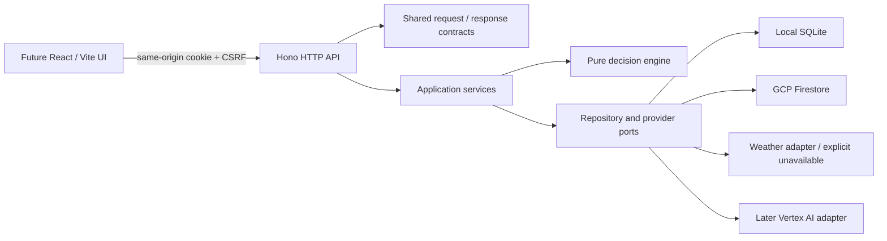

# Backend foundation: active batches and review log

Updated 17 October 2026. This document overrides the earlier migration-first delivery order: the user requested backend/contracts first and UI later. Work branch: `feat/api-foundation`. The earlier research/architecture documentation was published on main as `599ab97`.

## Scope

Build a project-free local API with production configuration seams, not a full agronomic service or UI. Implement sessions, capabilities, farms, assessments/comparison, saved plans and a machine-readable OpenAPI contract. Model-driven conversations, speech, satellite ingestion and a reviewed action corpus remain later milestones; advertise capability status honestly.

## Storage decision refinement

Default local mode uses Node 24's built-in SQLite driver: one durable file, no GCP account, no installed external database. Its Node experimental status is a local-tooling tradeoff; production never uses it. Firestore remains the production database, with an emulator option for parity tests. Both adapters implement atomic document reads/writes and bounded owner-scoped queries. Domain/services never depend on SQLite or Firestore SDK types.

Local process serialization is not distributed locking. SQLite transactions protect local operations; Firestore transactions protect deployed operations. No cross-request network calls occur inside database transactions. Token hashes, idempotency records and resource revisions are persisted rather than relying on process memory.

## Contracts

- Versioned `/api/v1` surface and `application/json` transport.
- Strict request schemas reject unknown owner/provider fields; response schemas are shared with clients.
- Success envelope: `{ data, meta: { requestId } }`. Error envelope: `{ error: { code, message, requestId, retryable, issues? } }`.
- Opaque IDs, ISO UTC timestamps, expected revision on updates, explicit hypothetical comparisons.
- Side-effectful creation requires an idempotency key scoped to owner + operation; same key/different payload returns 409.
- Paginated plan history uses an opaque validated cursor; clients cannot choose owner IDs.
- Session bootstrap supplies CSRF; cookie carries an opaque token and is HTTP-only. Production secure cookie and exact Origin validation; no wildcard CORS.
- OpenAPI is generated from the same Zod schemas/endpoint registry; a typed client checks runtime responses rather than trusting TypeScript alone.

## File ownership

| Path                   | Responsibility                                                      |
| ---------------------- | ------------------------------------------------------------------- |
| `packages/contracts/`  | Schemas, endpoint registry, OpenAPI                                 |
| `packages/domain/`     | Deterministic assessment, no SDK/network                            |
| `packages/api-client/` | Browser-safe typed Hono client                                      |
| `apps/api/src/`        | Configuration, composition, Hono, services, adapters                |
| `apps/api/tests/`      | API journeys, isolation and failure tests                           |
| `infra/`               | Container/build/configuration templates and Firestore rules/indexes |
| `docs/api/`            | API examples and generated specification                            |
| `docs/architecture/`   | Architecture diagrams and batch reviews                             |

## Batch gates

1. **Contracts/config:** strict validation, discriminated unavailable evidence, response envelopes, OpenAPI generation, deployment-mode guardrails. Review schema tests before proceeding.
2. **API/persistence:** complete local session → farm → assessment → compare → plan journey; ownership, expiry/CSRF, revision conflicts and idempotency tests. Firestore parity check separately identified.
3. **Packaging/review:** typecheck/build, black-box API tests, generated-contract drift checks, local restart persistence and deployment files. No cloud deployment until project setup exists.

## Review log

- Batch 1 complete: strict contracts, generated OpenAPI, typed client and pure workflow engine. Contract/domain/client suites pass (12 tests); public response validation and unavailable-evidence semantics are covered.
- Batch 2 complete: full guest → farm → assessment → comparison → plan journey, two-owner denial, linked-resource isolation, revisions, idempotency, CSRF, expiry, storage failures and pagination. API/infrastructure suite passes (16 tests). The same 10 API journey tests also pass against the official Firestore emulator using an isolated demo project, with no GCP account.
- Review fixes: serialize public SQLite reads behind writes; persist Firestore TTL values as timestamps; reject stale farm revisions before provider calls; replay assessments without fetching new evidence; label sessions as bootstrap/guest rather than account authentication; enforce client mutation/path/key requirements in TypeScript.
- Batch 3 complete: scoped build/typecheck and OpenAPI drift checks pass. The non-root container builds with a clean workspace-scoped install (audit: zero reported vulnerabilities). Real HTTP guest → farm → assessment → plan flow passes; the guest session, farm and plan survive container restart. CI repeats build, typecheck, tests, OpenAPI drift, emulator parity, container build and HTTP/restart smoke. This workspace required its proxy CA as a temporary BuildKit secret; TLS verification remained enabled.
- Existing frontend remains the Next starter. The old uncommitted Next API sketch was removed from the application tree. Updated engineering instructions and indexed API/auth/infra documentation accompany the implementation.

## Remaining gates

No live GCP resources, production IAM/index enforcement, live weather reliability, load performance or model behavior have been verified. The emulator emits an SDK metadata-discovery warning in this workspace; all parity tests pass. SQLite has no automatic expiry cleanup, so it is local tooling only. Guest sessions are not recoverable accounts. Assessments are unreviewed workflow checks, not agronomic prescriptions. Future account-provider and AI implementation must preserve the browser → Hono boundary.
