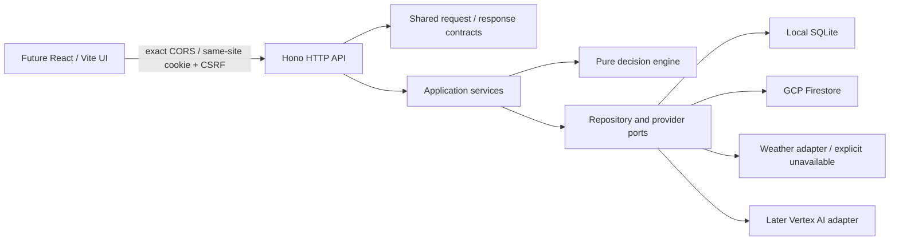

# Backend foundation: active batches and review log

**Current update (18 October 2026):** the voice-first public sample, Google adapters and historical rainfall are implemented and locally exercised. See [POC architecture](poc-implementation.md) for the current flow and limits. Earlier batch records below remain historical.

Updated 17 October 2026. This document overrides the earlier migration-first delivery order: the user requested backend/contracts first and UI later. Work branch: `feat/api-foundation`. The earlier research/architecture documentation was published on main as `599ab97`.

## Scope

Build a project-free local API with production configuration seams, not a full agronomic service or UI. Implement sessions, capabilities, farms, assessments/comparison, saved plans and a machine-readable OpenAPI contract. Model-driven conversations, speech, satellite ingestion and a reviewed action corpus remain later milestones; advertise capability status honestly.

## Storage decision refinement

Default local mode uses Node 24's built-in SQLite driver: one durable file, no GCP account, no installed external database. Its Node experimental status is a local-tooling tradeoff; production never uses it. Firestore remains the production database, with an emulator option for parity tests. Both adapters implement atomic document reads/writes and bounded owner-scoped queries. Domain/services never depend on SQLite or Firestore SDK types.

Local process serialization is not distributed locking. SQLite transactions protect local operations; Firestore transactions protect deployed operations. No cross-request network calls occur inside database transactions. Token hashes, idempotency records and resource revisions are persisted rather than relying on process memory.

## Contracts

- Versioned `/api/v1` surface and `application/json` transport.
- Strict request schemas reject unknown owner/provider fields; response schemas are shared with clients.
- Success envelope: `{ data, meta: { requestId } }`. Error envelope: `{ error: { code, message, requestId, retryable, issues? } }`.
- Opaque IDs, ISO UTC timestamps, expected revision on updates, explicit hypothetical comparisons.
- Side-effectful creation requires an idempotency key scoped to owner + operation; same key/different payload returns 409.
- Paginated plan history uses an opaque validated cursor; clients cannot choose owner IDs.
- Session bootstrap supplies CSRF; cookie carries an opaque token and is HTTP-only. Production secure cookie and exact Origin validation; no wildcard CORS.
- OpenAPI is generated from the same Zod schemas/endpoint registry; a typed client checks runtime responses rather than trusting TypeScript alone.

## File ownership

| Path                   | Responsibility                                                      |
| ---------------------- | ------------------------------------------------------------------- |
| `packages/contracts/`  | Schemas, endpoint registry, OpenAPI                                 |
| `packages/domain/`     | Deterministic assessment, no SDK/network                            |
| `packages/api-client/` | Browser-safe typed Hono client                                      |
| `apps/api/src/`        | Configuration, composition, Hono, services, adapters                |
| `apps/api/tests/`      | API journeys, isolation and failure tests                           |
| `infra/`               | Container/build/configuration templates and Firestore rules/indexes |
| `docs/api/`            | API examples and generated specification                            |
| `docs/architecture/`   | Architecture diagrams and batch reviews                             |

## Batch gates

1. **Contracts/config:** strict validation, discriminated unavailable evidence, response envelopes, OpenAPI generation, deployment-mode guardrails. Review schema tests before proceeding.
2. **API/persistence:** complete local session → farm → assessment → compare → plan journey; ownership, expiry/CSRF, revision conflicts and idempotency tests. Firestore parity check separately identified.
3. **Packaging/review:** typecheck/build, black-box API tests, generated-contract drift checks, local restart persistence and deployment files. No cloud deployment until project setup exists.

## Review log

- Batch 1 complete: strict contracts, generated OpenAPI, typed client and pure workflow engine. Contract/domain/client suites pass (12 tests); public response validation and unavailable-evidence semantics are covered.
- Batch 2 complete: full guest → farm → assessment → comparison → plan journey, two-owner denial, linked-resource isolation, revisions, idempotency, CSRF, expiry, storage failures and pagination. API/infrastructure suite passes (16 tests). The same 10 API journey tests also pass against the official Firestore emulator using an isolated demo project, with no GCP account.
- Review fixes: serialize public SQLite reads behind writes; persist Firestore TTL values as timestamps; reject stale farm revisions before provider calls; replay assessments without fetching new evidence; label sessions as bootstrap/guest rather than account authentication; enforce client mutation/path/key requirements in TypeScript.
- Batch 3 complete: scoped build/typecheck and OpenAPI drift checks pass. The non-root container builds with a clean workspace-scoped install (audit: zero reported vulnerabilities). Real HTTP guest → farm → assessment → plan flow passes; the guest session, farm and plan survive container restart. CI repeats build, typecheck, tests, OpenAPI drift, emulator parity, container build and HTTP/restart smoke. This workspace required its proxy CA as a temporary BuildKit secret; TLS verification remained enabled.
- At completion of the backend batch, the frontend remained the Next starter; [the subsequent web foundation](web-foundation.md) now replaces `apps/web` with React/Vite. The old uncommitted Next API sketch was removed from the application tree. Updated engineering instructions and indexed API/auth/infra documentation accompany the implementation.

## Remaining gates

No live GCP resources, production IAM/index enforcement, live weather reliability, load performance or model behavior have been verified. The emulator emits an SDK metadata-discovery warning in this workspace; all parity tests pass. SQLite has no automatic expiry cleanup, so it is local tooling only. Guest sessions are not recoverable accounts. Assessments are unreviewed workflow checks, not agronomic prescriptions. Future account-provider and AI implementation must preserve the browser → Hono boundary.

## GCP delivery follow-up

The [owner setup guide](../deployment/gcp-setup.md) and `infra/gcp/` now prepare keyless main-to-Cloud-Run deployment. Local deployment/rollback guard tests and application checks are distinct from live IAM/WIF/provisioning verification. The latter remains blocked by missing GCP identity; no cloud resources have been created.

## Independent serving follow-up

The owner's later requirement supersedes combined static/API serving. Hono no longer mounts web output. React assets are served by independent Nginx, with an exact configurable API origin and browser-safe typed RPC. Deployment stages two images/revisions and restores both services in reverse order on promotion/live-check failure; it does not claim atomic rollout or data rollback. Web has a separate runtime identity without Firestore permissions. See [deployment/recovery decision](gcp-deployment.md). Default run.app links verify health only; guest journeys require a later sibling-domain setup. Current validation results are recorded in the PR and final handoff; live GCP remains unverified.

Local review for the independent-serving batch: build/type/lint and OpenAPI checks passed; 31 contract/domain/client/API/infrastructure tests, 12 Firestore-emulator tests, 12 desktop/mobile/built-web browser checks, and 19 deployment/bootstrap guards passed. Both runtime images built; API HTTP workflow/restart persistence and the real Nginx/Hono browser smoke passed, including wrong-release rejection and API pause/recovery while web remains available. Runtime checks confirmed non-root users, no backend/Node runtime in the web image, and no web output/Vite/TypeScript in the API image. Mocked rollback tests are not live cloud verification. Existing builder-only development-tool audit advisories remain outside this change; no complete container vulnerability scan is claimed.

## Deadline handoff — 18 October 2026

The [eight-hour sprint](../submission/README.md) specifies the next implementation batch and intentionally cuts domain/auth/saved-plan UI from the public sample demo. No new public demo route, model adapter or farmer screen was implemented in this documentation handoff. A plan-only-by-default Google model diagnostic was added; offline tests cover identifier validation, Google endpoint selection and zero credential/network access without --run. It has not made a live provider call in Codex. Console access/billing are owner-confirmed, while actual runtime/model access remains to verify.

## Authorized live setup — 18 October 2026

This supersedes the earlier missing-identity/resource status above. The owner authenticated gcloud 589.0.0 locally and authorized main-to-Cloud-Run setup. Project read access, the setup account's Owner role and enabled billing were verified for `kavach-farmers-market-sense` (`62041733238`). Bootstrap created a deletion-protected Standard/Native Firestore database in `asia-south1`, Artifact Registry, separate API/web/deploy service accounts, both Cloud Run services and main/workflow/production-restricted GitHub federation. Bootstrap completed; the query index is READY and live deny-all client rules exactly match the committed file. Field-index exemptions and TTL settings submit asynchronously; a final read verified all exemptions, all three TTL policies ACTIVE and no pending/failed Firestore operations. GitHub has the main-only production environment, 13 non-secret variables and repository-level `GCP_DEPLOY_ENABLED=true`. No live model call is claimed.

Observed setup failures: a concurrent IAM-policy ETag conflict was retried without widening permissions. gcloud's actual missing-service message (`Cannot find service`) was not recognized by the bootstrap's optional lookup; a narrow fix and regression tests now distinguish that response from permission denial. The Mac's Python lacked a default CA bundle; using its existing `/etc/ssl/cert.pem` preserved TLS verification. Slow independent field-index/TTL maintenance now submits asynchronously rather than blocking each subsequent setting. All 14 JavaScript deployment guards and 13 Python bootstrap/model tests pass locally. These targeted checks do not claim a new full application build or live rollout.

The first CI attempt passed full verification but failed federation because this repository uses GitHub's immutable OIDC subject. Its customization API reports `repo:adwait-kalsekar@61903060/kavach@1421988948`. Bootstrap and the live provider now require exactly that prefix plus `:environment:production`, preserving independent numeric-ID, main, exact-workflow and push/manual-event checks. The administrator updated only the known legacy subject condition; mappings/issuer and all other restrictions remain unchanged. The failed deployment job then passed using the already tested image artifact. See [GitHub's immutable-subject reference](https://docs.github.com/en/actions/reference/security/oidc#immutable-subject-claims).

Verified IAM boundaries: only `kavach-runtime` has `roles/datastore.user`; web runtime has no project data/provider role. Deployer has Artifact Registry Writer on the application repository, Run Developer on each application service and Service Account User on the two runtime accounts. It has no project Owner/Editor, Firestore data or service IAM-policy administration role. No service-account keys were created. The first release remains the health foundation; public demo routes, farmer UI and Google-model integration remain unimplemented.

Live acceptance passed on 18 October at 11:07 UTC in [Actions run 39121310296, attempt 2](https://github.com/adwait-kalsekar/kavach/actions/runs/39121310296). Both services run commit `3be7b7a23c5513fea4bf28d4c8ef39210b14b4fc`, with revisions `kavach-api-r3be7b7a23c-39121310296-2` and `kavach-web-r3be7b7a23c-39121310296-2` each receiving 100% traffic. The workflow records tested image digests and previous revisions. Full CI verification passed, followed by real desktop/mobile browser checks for exact release headers, direct cross-origin API health, only the web/API network origins and Firestore readiness. Independent final HTTP checks confirmed exact-origin CORS/CSP, web `/api/v1/health` returns 404, API `/` returns 404 and both runtime identities remain distinct. No production farmer records were created for acceptance.

- Web: https://kavach-web-62041733238.asia-south1.run.app
- API health: https://kavach-api-62041733238.asia-south1.run.app/api/v1/health
- Storage readiness: https://kavach-api-62041733238.asia-south1.run.app/readyz

Remaining operations work: budget/uptime/error alerts and registry retention are not provisioned by bootstrap. Vertex AI enablement/runtime grants, model selection and real inference still belong to the model implementation batch. The earlier Google hello revisions are bootstrap placeholders, not known-good application rollback targets; this deployment establishes the first application baseline for future releases.

## Voice-first POC implementation (18 October 2026)

Added strict sample-only demo contracts, a dedicated cookie-free browser transport, deterministic sample comparison service, atomic minute/day paid-inference budgets and bounded WAV ingestion. Google GenAI, STT v2 and TTS adapters live exclusively in the API. Only exact demo path/method pairs bypass private session handling; exact-Origin checks still apply. Existing private guards are retained. Voice proposals require UI confirmation. No recording/transcript is persisted. Text explanations may be cached for fifteen minutes; no audio is cached in Firestore.

The packaged rainfall snapshot uses the documented NASA POWER fallback: Jun–Aug 2026 at the Latur district centre, compared with 1991–2020. It is coarse MERRA-2 grid context, not district mean or field measurement, and never enters agronomic decision rules. Earth Engine API enablement did not establish project registration. Local browser/provider validation now passes; see [POC architecture](poc-implementation.md) for evidence and limitations. This change is not yet deployed. User explicitly requested no new test cases; existing checks and manual validation will be used.

## Conversational UX batch — 18 October 2026

The redesign adds strict `POST /api/v1/demo/message` typed input, with bounded text/locale/voice fields and the same server-owned closed-intent interpreter and shared paid quotas as voice. Its exact path/method is added to the public demo allowlist; private guards are unchanged. Only water changes require confirmation. Read-only interpreted requests may proceed to a grounded explanation. Confirmation speech is generated only for water proposals; no arbitrary input text is synthesized. The multi-route conversation UI is implemented and manually exercised with real Google typed/voice calls; see [current architecture and verification](poc-implementation.md). Legacy voice responses retain their prior confirmation flag; the new typed response exposes intent-specific confirmation. Final existing-suite checks accompany this batch.

## Farmer water-planning batch — 18 October 2026

The new bounded planning contracts, pure one-application water arithmetic, exact public Hono routes and typed client build successfully (`build:app`). Three dated NASA POWER centre-grid exports are packaged for Latur, Beed and Nanded; all matched June–August daily values were checked for completeness and missing/fill values by the reproducible exporter. Crop labels (chickpea/sorghum/wheat) do not change assumed depth or efficiency. The new calculation is stateless and explicitly unreviewed; historical rainfall is independent context. Optional explanation and transcription share existing atomic paid quotas, with no arbitrary-input explanation cache. UI integration and full verification are in progress; no production rollout claimed.

### Farmer-flow integration review

The farmer-first routes now use a dedicated planning provider; `/health` does not instantiate it. Input drafts are confirmed or cancelled, and confirming clears prior selection/chat context. The farmer's chosen location/crop/area/water, language and spoken-reply preference stay in visit memory; no profile persistence was introduced. Optional typed/voice conversation uses current canonical plan context and bounded untrusted history. Known zero water is now explicitly supported (unlike unknown/null), a deliberate improvement to the draft plan's original positive-water bound. The new explanation/transcription paths reserve the existing shared quotas. Existing API suite, build and type/lint/boundary checks pass so far. Final browser, emulator/container and deployment verification are tracked separately; no new tests or cloud IAM changes were added.

### Final local verification and review

Build, type/lint/boundary/RPC checks, OpenAPI drift, existing API suites, deployment guards, Firestore emulator parity and 12 browser tests passed. Exploratory browser checks exercised location/crop selection, reversible edits, known zero/unknown water, invalidation, sources, print, retained chat, actual Google text/STT/English/Marathi audio, denied mic and network recovery with only the two app origins. API probes confirmed wrong Origin 403, unknown owner/negative input 400, body overflow 413, no public cookies and private unauthenticated denial. Both images built; HTTP/restart persistence and independent two-container/CSP/release/outage smoke passed. Local container smoke was corrected to select its explicitly disabled provider and `/health`; production still requires genuine configured Google output and audio. Independent read-only review found two P2 receipt omissions; signed balance and print-visible method/application limits are fixed. Final A4 sheet is one page. No new test cases, dependency changes, IAM changes or cloud keys were added. Native-phone/language/agronomic/user-outcome validation remains unperformed. The next main rollout must verify attached-runtime Google access and exact release images.

### UI alignment and full Talk route

The user found the React styling had drifted from the HTML and rejected dialog chat. The refinement replaces layered overrides with an isolated planning stylesheet, restores prototype spacing/colors, adds a decorative field illustration and moves contextual typed/voice interaction to `/talk` in the same visit provider. Talk has a dedicated conversation scroll and visible composer; read-only speech questions send after tap-to-finish, with explicit recording cancellation. Leaving/changing language cancels old work; numeric edits still require the planning input confirmation flow. Hono routes/contracts and private guards are unchanged. The first release f534908 passed verify+deployment in CI 39130726106, including real runtime Google/model/audio smoke. The UI refinement requires a new tested main rollout. Future generative UI/onboarding research is kept under ignored `.context/next-features/`; neither feature is claimed implemented, and no personal-data local storage was added.

The UI refinement passes build/check and the 12 existing browser cases. Its separate Nginx/API container walkthrough passes both viewport tasks and the explicit disabled-provider state. Manual Playwright verifies typed/voice replies, recording cancellation, profile retention, one-page print and a 390×540 composer. Follow-up review found an overlap between microphone startup and typed/retry submission; a synchronous phase guard now serializes startup, recording, transcription and answering. Startup disables sending, recording clears stale retry state, and cancellation sends no provider call. Future research is saved in `.context/next-features/generative-ui.md` and `guided-walkthrough.md` and has not added application dependencies or new browser persistence.

### Cost-control verification — 18 October 2026

The owner completed Earth Engine registration; the live configuration reports noncommercial registration and constant compute succeeded. A daily consumer quota of 3,600 EECU-seconds was requested and verified separately from the producer monthly allocation of 540,000 seconds. No satellite export, recurring pipeline, runtime Earth Engine permission or browser/provider connection was added. Both live Cloud Run service maxima were reduced to one; revision deploy/bootstrap defaults now retain max one, min zero. A project-scoped INR 1,000 monthly gross-usage alert budget excludes credits and has actual 50/90/100% plus forecasted 100% thresholds. These are exposure controls, not a guaranteed bill cap or automated billing shutdown. Free Trial versus upgraded paid status still requires owner console confirmation. See the cost safeguards in the deployment setup guide for operational limitations.

### Navigation cleanup before readiness integration

Removed the redundant Next Steps navigation destination. The three primary tabs are situation, comparison and Talk. A selected water comparison opens `/discussion-sheet`, with its actual water gap/remaining balance, source checks and print. Direct legacy `/next-steps` links return to comparison, and an unselected discussion-sheet link cannot imply a saved plan. No API/security/provider behavior changed. Local verification is recorded in the current readiness execution ledger.

### Seasonal-readiness backend batch

Packaged actual ten-region CHIRPS monsoon history, ERA5 September modeled surface moisture/air heat and NOAA ONI, plus thirty historical district/crop context entries with source pages and review/freshness state. Pure `assessSeason` matches context and emits verification tasks, not unreviewed prescriptions or invented crop-loss probabilities. Added two exact public routes, typed client/contracts and bounded grounded seasonal explanation with finite evidence-view selection. Existing private security and shared paid budgets remain. See season-readiness.md for formulas, sources, reproducibility and gaps. Build/check and outgoing-pack validation are the current batch gates; frontend integration and deployment remain subsequent work.

### Seasonal frontend and walkthrough integration

My season exposes ten district/three crop selections, decision intent, field/stage prerequisites, monsoon history, modeled surface context and source/calendar details in focused views. Talk retains text/voice and renders canonical seasonal/history/surface/action/water components from a finite Google topic vocabulary. The six-step walkthrough highlights rendered targets and stores only a versioned completion flag. Browser inspection caught legacy global illustration positioning over profile selectors; its class is now isolated. Build/type/lint/boundary/RPC checks pass; full browser/container/live verification remains the release gate. No claim of reviewed agronomy or calibrated farm risk.

### Decide-layer extension after brief alignment review

The user reiterated exact brief alignment before release. Extended the backend from verification tasks to seven actual source-conditioned crop discussion rules, applied across thirty district/crop contexts with general/district scope explicit. Added crop-specific stages, one-irrigation choice and conditional soil-type/well-recharge facts. An experimental regional water-stress indicator uses baseline rainfall/moisture ranks and a documented driest-fifth threshold; it is not a calibrated farm-loss score. New rule status distinguishes checked reported context, unknown prerequisites and different situations; local agronomic review is still required. Sources and formulas are in season-readiness.md. The earlier evidence/checkpoint baseline passed twelve existing e2e cases, API/deploy checks and independent real-container smoke. Revalidation of this additional core extension is underway before main rollout.

### Readiness release verification

The current extension passed build/type/lint/browser-boundary and negative RPC checks, generated OpenAPI drift, existing API/contracts/domain/client and deployment suites, and all twelve existing Playwright cases. Exploratory runtime checks parsed all thirty district/crop combinations and verified exact source scope, bounded ranks, maturity exclusion and stage/one-irrigation differences. Mobile browser checks exercised chickpea two-stage water uncertainty, wheat crown-root matching, unverified district open-well conditions and substantive Hindi/Marathi cards, with exactly the web/API origins, no page errors or overflow. Real API persistence/restart and independent Nginx/API container smoke passed. Release review corrected translated probability disclaimers and tightened source prerequisites. No new test cases or cloud services were added. The final exploratory walkthrough also passed genuine Google typed and microphone/STT/model/TTS flows, canonical rain/action cards, compact and desktop layouts, tour persistence, no page errors and exact two-origin traffic. Production rollout verification is still pending for this commit.

### Production smoke timeout investigation

The first `7f3a41a` rollout passed all verify checks, but its genuine Google explanation reached the 25-second deadline and correctly returned unavailable; deployment smoke rejected it and restored both services to `05b96bb`. A bounded diagnostic request to the exact candidate revision subsequently returned genuine Google explanation and audio in 16.2 seconds, confirming the provider worked and the failure was intermittent latency rather than evidence/routing. The temporary diagnostic tag was removed without changing production traffic. Tightened inference context to omit raw baseline series, duplicated guidance and unrelated legacy climate data; all server-validated numbers, conditions, missing facts and canonical UI components remain intact. Timeout messages and smoke assertions now identify the failed stage without exposing provider errors or credentials. A follow-up compact-payload local call also reached the original deadline, so payload size alone is not established as the cause. Seasonal explanation plus optional TTS now share a bounded 35-second deadline, below the 60-second Cloud Run request limit and the 40-second live-smoke response limit. Paid quotas, output-token bounds, no-retry policy and required real-model smoke remain unchanged. The revised request passed genuine Google explanation/audio locally in 8.7 seconds; build/type/lint/boundary/RPC/API/deployment/OpenAPI checks passed. Rollout and its independent live verification remain pending.

### Language persistence and input-based speech

The user requested language persistence and voice output only for microphone input. Planning stores a whitelisted locale in browser local storage, with safe English fallback when missing/invalid and graceful behavior if storage is blocked. No database/account identity was introduced. Typed/suggested questions send `voice: false`; microphone questions send `voice: true`, and retry retains modality. Removed the global sound toggle; text answers do not mount audio or show a missing-audio notice. Existing public contracts/quotas remain unchanged. Deployment smoke now requires a genuine Google typed answer with unavailable audio and no audio element, matching the requested behavior; microphone/STT/model/TTS remains an independent exploratory walkthrough. The generative-UI research pack was read: current finite canonical evidence components implement its first slice; authored concept modules, deterministic follow-ups and licensed locator maps remain separate future batches, not claimed implemented.

Latest local checks passed build/type/lint/boundary/RPC, API/deployment/OpenAPI suites and twelve existing e2e cases. Exploratory Playwright passed real typed Google reply without audio, microphone/STT/Google/TTS reply with audio, Marathi refresh persistence, invalid-locale fallback and blocked-storage recovery. Context/profile remain visit-only. No new test cases were added.

### Next bounded generative-UI batch

The user requested continuing the saved experience research. Next: deterministic educational controls within the existing model-selected canonical cards—matching baseline/year comparison, a sourced El Niño concept, field-versus-regional evidence limits, source receipts and historical/hypothetical guidance distinctions. These local controls use each card’s immutable assessment; they need no model call, framework, route, geometry or farm mutation. These controls are now implemented locally and use existing server-computed totals/departures and immutable card snapshots. No API/view contract or new model topic was introduced. Mobile/desktop exploratory checks passed canonical year values, NOAA concept steps, limits, focus restoration, Hindi/Marathi, no overflow/page errors and zero extra requests. Current main deployment verification remains independent.

### Inference latency follow-up

Main `a5f7dd1` passed deployment and genuine Google smoke. A subsequent real Nanded/wheat history request reached the 35-second deadline; request logs confirmed timeout, while evidence fallback remained usable. Google’s official model docs support MINIMAL for 3.6 Flash but reject it for 3.8 Flash. A representative 3.6/MINIMAL request passed in 2.3 seconds with canonical history/action selection and no text-input audio. Changed validated local/deploy defaults to 3.6 and use MINIMAL only for that exact model; other explicit model overrides retain LOW. Existing paid/output/deadline limits remain unchanged. This is a configuration choice based on this task’s bounded explanation needs and observed latency, not a model-wide performance claim. The full local typed/STT/model/TTS walkthrough passed with silent typed replies, spoken microphone replies, preserved locale and exact two-origin traffic. Final build/type/lint/boundary/negative RPC, API/contracts/domain/client, deployment/OpenAPI and twelve existing e2e cases passed; no new test cases. Production rollout verification remains pending for this batch.
