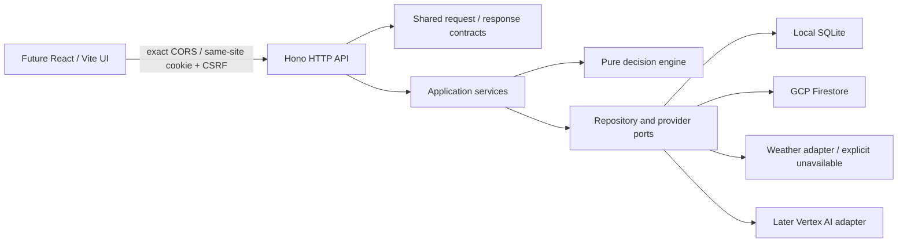

# Backend foundation: active batches and review log

Updated 17 October 2026. This document overrides the earlier migration-first delivery order: the user requested backend/contracts first and UI later. Work branch: `feat/api-foundation`. The earlier research/architecture documentation was published on main as `599ab97`.

## Scope

Build a project-free local API with production configuration seams, not a full agronomic service or UI. Implement sessions, capabilities, farms, assessments/comparison, saved plans and a machine-readable OpenAPI contract. Model-driven conversations, speech, satellite ingestion and a reviewed action corpus remain later milestones; advertise capability status honestly.

## Storage decision refinement

Default local mode uses Node 24's built-in SQLite driver: one durable file, no GCP account, no installed external database. Its Node experimental status is a local-tooling tradeoff; production never uses it. Firestore remains the production database, with an emulator option for parity tests. Both adapters implement atomic document reads/writes and bounded owner-scoped queries. Domain/services never depend on SQLite or Firestore SDK types.

Local process serialization is not distributed locking. SQLite transactions protect local operations; Firestore transactions protect deployed operations. No cross-request network calls occur inside database transactions. Token hashes, idempotency records and resource revisions are persisted rather than relying on process memory.

## Contracts

- Versioned `/api/v1` surface and `application/json` transport.
- Strict request schemas reject unknown owner/provider fields; response schemas are shared with clients.
- Success envelope: `{ data, meta: { requestId } }`. Error envelope: `{ error: { code, message, requestId, retryable, issues? } }`.
- Opaque IDs, ISO UTC timestamps, expected revision on updates, explicit hypothetical comparisons.
- Side-effectful creation requires an idempotency key scoped to owner + operation; same key/different payload returns 409.
- Paginated plan history uses an opaque validated cursor; clients cannot choose owner IDs.
- Session bootstrap supplies CSRF; cookie carries an opaque token and is HTTP-only. Production secure cookie and exact Origin validation; no wildcard CORS.
- OpenAPI is generated from the same Zod schemas/endpoint registry; a typed client checks runtime responses rather than trusting TypeScript alone.

## File ownership

| Path                   | Responsibility                                                      |
| ---------------------- | ------------------------------------------------------------------- |
| `packages/contracts/`  | Schemas, endpoint registry, OpenAPI                                 |
| `packages/domain/`     | Deterministic assessment, no SDK/network                            |
| `packages/api-client/` | Browser-safe typed Hono client                                      |
| `apps/api/src/`        | Configuration, composition, Hono, services, adapters                |
| `apps/api/tests/`      | API journeys, isolation and failure tests                           |
| `infra/`               | Container/build/configuration templates and Firestore rules/indexes |
| `docs/api/`            | API examples and generated specification                            |
| `docs/architecture/`   | Architecture diagrams and batch reviews                             |

## Batch gates

1. **Contracts/config:** strict validation, discriminated unavailable evidence, response envelopes, OpenAPI generation, deployment-mode guardrails. Review schema tests before proceeding.
2. **API/persistence:** complete local session → farm → assessment → compare → plan journey; ownership, expiry/CSRF, revision conflicts and idempotency tests. Firestore parity check separately identified.
3. **Packaging/review:** typecheck/build, black-box API tests, generated-contract drift checks, local restart persistence and deployment files. No cloud deployment until project setup exists.

## Review log

- Batch 1 complete: strict contracts, generated OpenAPI, typed client and pure workflow engine. Contract/domain/client suites pass (12 tests); public response validation and unavailable-evidence semantics are covered.
- Batch 2 complete: full guest → farm → assessment → comparison → plan journey, two-owner denial, linked-resource isolation, revisions, idempotency, CSRF, expiry, storage failures and pagination. API/infrastructure suite passes (16 tests). The same 10 API journey tests also pass against the official Firestore emulator using an isolated demo project, with no GCP account.
- Review fixes: serialize public SQLite reads behind writes; persist Firestore TTL values as timestamps; reject stale farm revisions before provider calls; replay assessments without fetching new evidence; label sessions as bootstrap/guest rather than account authentication; enforce client mutation/path/key requirements in TypeScript.
- Batch 3 complete: scoped build/typecheck and OpenAPI drift checks pass. The non-root container builds with a clean workspace-scoped install (audit: zero reported vulnerabilities). Real HTTP guest → farm → assessment → plan flow passes; the guest session, farm and plan survive container restart. CI repeats build, typecheck, tests, OpenAPI drift, emulator parity, container build and HTTP/restart smoke. This workspace required its proxy CA as a temporary BuildKit secret; TLS verification remained enabled.
- At completion of the backend batch, the frontend remained the Next starter; [the subsequent web foundation](web-foundation.md) now replaces `apps/web` with React/Vite. The old uncommitted Next API sketch was removed from the application tree. Updated engineering instructions and indexed API/auth/infra documentation accompany the implementation.

## Remaining gates

No live GCP resources, production IAM/index enforcement, live weather reliability, load performance or model behavior have been verified. The emulator emits an SDK metadata-discovery warning in this workspace; all parity tests pass. SQLite has no automatic expiry cleanup, so it is local tooling only. Guest sessions are not recoverable accounts. Assessments are unreviewed workflow checks, not agronomic prescriptions. Future account-provider and AI implementation must preserve the browser → Hono boundary.

## GCP delivery follow-up

The [owner setup guide](../deployment/gcp-setup.md) and `infra/gcp/` now prepare keyless main-to-Cloud-Run deployment. Local deployment/rollback guard tests and application checks are distinct from live IAM/WIF/provisioning verification. The latter remains blocked by missing GCP identity; no cloud resources have been created.

## Independent serving follow-up

The owner's later requirement supersedes combined static/API serving. Hono no longer mounts web output. React assets are served by independent Nginx, with an exact configurable API origin and browser-safe typed RPC. Deployment stages two images/revisions and restores both services in reverse order on promotion/live-check failure; it does not claim atomic rollout or data rollback. Web has a separate runtime identity without Firestore permissions. See [deployment/recovery decision](gcp-deployment.md). Default run.app links verify health only; guest journeys require a later sibling-domain setup. Current validation results are recorded in the PR and final handoff; live GCP remains unverified.

Local review for the independent-serving batch: build/type/lint and OpenAPI checks passed; 31 contract/domain/client/API/infrastructure tests, 12 Firestore-emulator tests, 12 desktop/mobile/built-web browser checks, and 19 deployment/bootstrap guards passed. Both runtime images built; API HTTP workflow/restart persistence and the real Nginx/Hono browser smoke passed, including wrong-release rejection and API pause/recovery while web remains available. Runtime checks confirmed non-root users, no backend/Node runtime in the web image, and no web output/Vite/TypeScript in the API image. Mocked rollback tests are not live cloud verification. Existing builder-only development-tool audit advisories remain outside this change; no complete container vulnerability scan is claimed.

## Deadline handoff — 18 October 2026

The [eight-hour sprint](../submission/README.md) specifies the next implementation batch and intentionally cuts domain/auth/saved-plan UI from the public sample demo. No new public demo route, model adapter or farmer screen was implemented in this documentation handoff. A plan-only-by-default Google model diagnostic was added; offline tests cover identifier validation, Google endpoint selection and zero credential/network access without --run. It has not made a live provider call in Codex. Console access/billing are owner-confirmed, while actual runtime/model access remains to verify.

## Authorized live setup — 18 October 2026

This supersedes the earlier missing-identity/resource status above. The owner authenticated gcloud 589.0.0 locally and authorized main-to-Cloud-Run setup. Project read access, the setup account's Owner role and enabled billing were verified for `kavach-farmers-market-sense` (`62041733238`). Bootstrap created a deletion-protected Standard/Native Firestore database in `asia-south1`, Artifact Registry, separate API/web/deploy service accounts, both Cloud Run services and main/workflow/production-restricted GitHub federation. Bootstrap completed; the query index is READY and live deny-all client rules exactly match the committed file. Field-index exemptions and TTL settings submit asynchronously; a final read verified all exemptions, all three TTL policies ACTIVE and no pending/failed Firestore operations. GitHub has the main-only production environment, 13 non-secret variables and repository-level `GCP_DEPLOY_ENABLED=true`. No live model call is claimed.

Observed setup failures: a concurrent IAM-policy ETag conflict was retried without widening permissions. gcloud's actual missing-service message (`Cannot find service`) was not recognized by the bootstrap's optional lookup; a narrow fix and regression tests now distinguish that response from permission denial. The Mac's Python lacked a default CA bundle; using its existing `/etc/ssl/cert.pem` preserved TLS verification. Slow independent field-index/TTL maintenance now submits asynchronously rather than blocking each subsequent setting. All 14 JavaScript deployment guards and 13 Python bootstrap/model tests pass locally. These targeted checks do not claim a new full application build or live rollout.

The first CI attempt passed full verification but failed federation because this repository uses GitHub's immutable OIDC subject. Its customization API reports `repo:adwait-kalsekar@61903060/kavach@1421988948`. Bootstrap and the live provider now require exactly that prefix plus `:environment:production`, preserving independent numeric-ID, main, exact-workflow and push/manual-event checks. The administrator updated only the known legacy subject condition; mappings/issuer and all other restrictions remain unchanged. The failed deployment job then passed using the already tested image artifact. See [GitHub's immutable-subject reference](https://docs.github.com/en/actions/reference/security/oidc#immutable-subject-claims).

Verified IAM boundaries: only `kavach-runtime` has `roles/datastore.user`; web runtime has no project data/provider role. Deployer has Artifact Registry Writer on the application repository, Run Developer on each application service and Service Account User on the two runtime accounts. It has no project Owner/Editor, Firestore data or service IAM-policy administration role. No service-account keys were created. The first release remains the health foundation; public demo routes, farmer UI and Google-model integration remain unimplemented.

Live acceptance passed on 18 October at 11:07 UTC in [Actions run 39121310296, attempt 2](https://github.com/adwait-kalsekar/kavach/actions/runs/39121310296). Both services run commit `3be7b7a23c5513fea4bf28d4c8ef39210b14b4fc`, with revisions `kavach-api-r3be7b7a23c-39121310296-2` and `kavach-web-r3be7b7a23c-39121310296-2` each receiving 100% traffic. The workflow records tested image digests and previous revisions. Full CI verification passed, followed by real desktop/mobile browser checks for exact release headers, direct cross-origin API health, only the web/API network origins and Firestore readiness. Independent final HTTP checks confirmed exact-origin CORS/CSP, web `/api/v1/health` returns 404, API `/` returns 404 and both runtime identities remain distinct. No production farmer records were created for acceptance.

- Web: https://kavach-web-62041733238.asia-south1.run.app
- API health: https://kavach-api-62041733238.asia-south1.run.app/api/v1/health
- Storage readiness: https://kavach-api-62041733238.asia-south1.run.app/readyz

Remaining operations work: budget/uptime/error alerts and registry retention are not provisioned by bootstrap. Vertex AI enablement/runtime grants, model selection and real inference still belong to the model implementation batch. The earlier Google hello revisions are bootstrap placeholders, not known-good application rollback targets; this deployment establishes the first application baseline for future releases.
