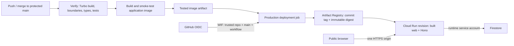

# GCP deployment and continuous delivery

Researched 17 October 2026 against official Google documentation. This is the selected deployment plan, not implemented continuous delivery or a live deployment. The current CI verifies the application; `infra/cloudbuild.yaml` only builds/pushes an image. No GCP project is configured.

## Selected topology

Deploy one application container to Cloud Run. React/Vite and Hono remain separate source/build units but ship in one revision. Hono serves web assets and all API calls on the same HTTPS origin. Firestore is persistent storage; local SQLite is prohibited in production. Keep the docs starter outside this image.

An atomic application revision avoids deploying a frontend that expects a different API/RPC contract. Turbo is the build scheduler/cache, not the deployment platform. `npm run build:app` follows the workspace dependency graph, including the type-only API → client → UI dependency. Build all application dependencies on every main commit initially; caches can reuse unchanged outputs. Avoid selective path filters until cross-package changes and deployment ordering have explicit coverage.

## Services required

| Service                            | Responsibility                                                     |
| ---------------------------------- | ------------------------------------------------------------------ |
| Cloud Run                          | HTTPS URL, application revisions, autoscaling and runtime identity |
| Artifact Registry                  | Private container repository and immutable image digests           |
| Firestore Standard / Native mode   | Farms, sessions, assessments, plans, idempotency and quotas        |
| IAM / Workload Identity Federation | Short-lived GitHub deployment access; separate runtime identity    |
| Cloud Logging / Monitoring         | Application logs, readiness/error metrics and uptime checks        |
| Cloud Billing                      | Linked billing account, budget alerts and usage visibility         |
| Secret Manager, later              | Server-side provider credentials, if needed                        |
| Vertex AI, later                   | AI/model inference; not needed to deploy the health foundation     |

Default recommendation: dedicated Kavach project, Cloud Run/Artifact Registry/Firestore in `asia-south1` (Mumbai), subject to actual project availability and any existing database location. Firestore location cannot be changed after provisioning; inspect an existing database before creating anything. Cloud Run supports the current Node HTTP container and injected PORT; no Express migration or VM is required.

Cloud Run supplies a managed HTTPS `run.app` URL. A custom domain, purchased certificate, load balancer and separate frontend hosting are unnecessary for the first public link. Use one canonical origin for sessions/CSRF. For a short service name such as `kavach-api`, Google's deterministic URL is `https://SERVICE_NAME-PROJECT_NUMBER.REGION.run.app`; confirm the service-reported URL before publishing. This lets the initial deploy configure exact APP_ORIGIN without weakening origin validation or introducing temporary permissive defaults.

## Main-to-production pipeline

Extend the existing GitHub Actions workflow rather than adding a second independent deployment trigger:

1. PRs and main run the existing verification job: pinned Node/npm, lockfile install, import and bundle boundaries, Turbo build/typecheck, API tests, OpenAPI drift, desktop/mobile/Hono-served browser tests, Firestore emulator parity and container smoke.
2. Make the container builder use the same `npm run build:app` Turbo dependency graph, with required build tooling installed in the builder only. Its current explicit workspace build sequence is correct for today's packages; a single Turbo entry point avoids having to maintain that order separately as the graph grows. Keep the clean production dependency stage.
3. For a successful main run only, export the already smoke-tested image as a short-lived workflow artifact. A separate production job downloads/loads that exact image; do not rebuild an unverified image after tests.
4. Production job alone receives `id-token: write` and exchanges GitHub OIDC through WIF for the deploy service account. The verification job has only read access and no cloud identity. Never use `pull_request_target` to execute contributor code with deployment access.
5. Push the image to Artifact Registry, label/tag it with the source commit, and deploy its immutable `sha256` digest. Do not deploy a floating `latest` tag. Pin third-party action versions to reviewed commit SHAs.
6. Use a GitHub `production` environment restricted to main. Allow automatic deployment after successful main verification as requested; a manual environment reviewer is optional, not required by this design.
7. Serialize production deployments and reject stale SHAs before promotion, so an older slow build cannot replace a newer release. Don't cancel an in-flight traffic change. Record previous revision/digest and perform a final stale-commit check before moving traffic.
8. Create the candidate revision with no production traffic, wait for readiness, then promote through the stable service URL. Run public health and browser checks there, including the guest/farm/assessment/plan journey. Clean up smoke records through a server/admin process. Roll back traffic to the previous revision if post-promotion checks fail.

A revision traffic-tag URL is an alternate origin. Our exact-origin CSRF checks will intentionally reject browser mutations there. Don't relax APP_ORIGIN for previews: candidate readiness can run before promotion, but full mutation journeys should use the canonical production URL after promotion, or a separate staging service with its own configured origin/database.

Infrastructure provisioning, database/index/TTL changes and IAM changes are reviewed bootstrap/infrastructure operations, not side effects of every application push. Application schema changes must remain compatible with the previous revision to make traffic rollback safe. Rollback does not undo Firestore data changes.

Cloud Build repository triggers are a supported alternative. They are not selected here because this repo already has comprehensive GitHub Actions gates. Running a separate direct-to-Cloud-Run trigger could deploy a commit before those gates succeed. Cloud Build can remain a manual build option; don't enable two production deploy controllers.

## Identities and permissions

| Identity                               | Scope / permissions                                                                                                                                                                                                                                                                                        |
| -------------------------------------- | ---------------------------------------------------------------------------------------------------------------------------------------------------------------------------------------------------------------------------------------------------------------------------------------------------------- |
| One-time bootstrap operator            | Enable APIs; create registry/database/accounts/WIF; configure IAM, public access, indexes/TTL and budgets. Use an existing authorized project admin or reviewed bootstrap script; do not make application CI an Owner/Editor.                                                                              |
| GitHub deployment service account      | `roles/artifactregistry.writer` on the application repository; `roles/run.developer` on the existing service; `roles/iam.serviceAccountUser` on the runtime account. Writer includes image read access needed for deployment. Initial resource creation/public-access changes remain bootstrap operations. |
| Trusted GitHub WIF principal           | `roles/iam.workloadIdentityUser` on the deployment account, restricted to this repository and branch/workflow.                                                                                                                                                                                             |
| Cloud Run runtime service account      | `roles/datastore.user` for application data in the dedicated project/database scope. No deploy, IAM or registry-write rights. Future Secret Manager access is limited to particular required secrets.                                                                                                      |
| Google-managed Cloud Run service agent | Platform-managed image-pull/runtime service-agent duties; don't confuse it with the application's runtime account or grant its role to GitHub.                                                                                                                                                             |

Use numeric GitHub repository and owner IDs in WIF conditions to prevent deleted-name reuse. Also bind `refs/heads/main`, the expected workflow and intended environment/issuer/audience. The IAM provider and GitHub environment must agree on the token claims; naming a GitHub environment alone does not establish cloud trust.

Cloud Run uses its attached runtime service identity and Application Default Credentials. Do not ship GOOGLE_APPLICATION_CREDENTIALS files, service-account JSON keys or CI OIDC credentials in the image. Existing production validation rejects local credential-file configuration. Current weather-disabled/AI-unavailable deployment needs no model or third-party API key.

Public browser access must be configured deliberately during bootstrap. Google currently recommends disabling the service's Invoker IAM check for a public site, where organization policy permits it; `allUsers` + Run Invoker is another supported route. Check organization constraints first. Public transport access does not remove Hono session/CSRF/ownership checks on private records.

## Inputs needed from the owner

Safe to share in chat:

| Input                                         | Default / reason                                                                      |
| --------------------------------------------- | ------------------------------------------------------------------------------------- |
| GCP project ID                                | Required; the project number can be looked up after authorized access                 |
| Billing enabled / attached                    | Required for provisioning and usage; don't share payment details                      |
| Region and any existing Firestore location    | Recommend `asia-south1`; preserve existing location constraints                       |
| Public access allowed                         | Needed for a link judges can open without Google IAM login                            |
| Monthly budget target and alert recipient     | Defines alerts and initial operating limits                                           |
| GitHub repository administration availability | Needed to configure WIF-related variables, production environment and main protection |

No custom domain is required; service/repository names can use the documented defaults. If the project is organization-managed, the owner should identify an administrator who can resolve public-access or federation policy restrictions.

Generated non-secret GitHub environment variables will be:

- GCP_PROJECT_ID, GCP_PROJECT_NUMBER, GCP_REGION
- GCP_WORKLOAD_IDENTITY_PROVIDER (full provider resource name)
- GCP_DEPLOY_SERVICE_ACCOUNT, GCP_RUNTIME_SERVICE_ACCOUNT
- GCP_ARTIFACT_REPOSITORY, GCP_CLOUD_RUN_SERVICE
- APP_ORIGIN, FIRESTORE_DATABASE_ID

These are configuration identifiers, not credentials. The WIF trust policy supplies authorization. Future provider secrets belong in Secret Manager, not chat, GitHub variables or Vite settings.

## Codex cloud computer access

Observed 17 October 2026: this session's environment status reports **no GCP outbound identity, runtime variables or secrets**, and no identity manifest is configured. `gcloud` is not installed. Existing GitHub access is working; it does not grant Google Cloud access.

Preferred setup paths:

1. Configure an authorized GCP outbound identity/connection in the Codex cloud environment, if that option is available to the owner. Select a dedicated bootstrap/deployment identity, review its scope, and let the environment report it ready. Install the official gcloud CLI and use its provided profile/credential selectors normally. Never paste tokens or private keys into chat.
2. If no GCP connection is available, the owner runs a reviewed one-time bootstrap script in Google Cloud Shell under their existing authorized login. It configures GCP/WIF and produces only non-secret IDs for the repository settings. After that, GitHub Actions can build/deploy on main without any GCP credential stored on the Codex computer. This path is sufficient for automatic delivery.

Do not request a long-lived service-account JSON key as the default fallback. A configured Codex identity and GitHub OIDC federation are separate access paths; one does not automatically establish the other.

## Bootstrap and acceptance checklist

- Confirm project/billing, location, quotas and policy permissions. Enable Cloud Run, Artifact Registry, Firestore, IAM Credentials, Security Token Service and required IAM APIs; add Secret Manager/Vertex AI when those features are enabled.
- Create the regional registry and Firestore Native database; apply deny-client rules, required indexes and TTL policies. Wait for indexes to become ready. Admin SDK access is governed by IAM, not Firestore client rules.
- Create separate runtime/deploy identities and constrained GitHub federation; record settings in a production environment. Limit its deployable branch to main and enable main branch protection with required CI checks.
- Provision the Cloud Run service, canonical origin, public-access policy and initial image. Keep min instances 0, initial max instances 3, 1 vCPU/512 MiB and request-based billing as a small POC starting point, subject to measured memory/startup/concurrency needs. These settings are not load-tested guarantees.
- Configure budget alerts, registry cleanup policy and basic uptime/error monitoring. Alerts-only budgets do not cap spend. Google's newer spend-cap budgets have service/account support restrictions; check eligibility separately instead of assuming a universal hard cap. Scaling limits also do not cap total cost.
- Verify URL/HTML/static assets and real typed health in a browser; secure cookies, exact Origin, cross-owner denial, plan persistence across revisions and graceful shutdown. Confirm no frontend cloud SDK or secret is present.
- Merge a harmless main change, verify the new commit/digest/revision reaches the same URL only after CI passes, then exercise rollback. Record the final service URL and operating instructions in docs.

## Official sources

- [Cloud Run container contract](https://docs.cloud.google.com/run/docs/container-contract)
- [Cloud Run HTTPS and deterministic URLs](https://docs.cloud.google.com/run/docs/triggering/https-request)
- [Public access and Invoker IAM check](https://docs.cloud.google.com/run/docs/authenticating/public)
- [Deployment roles and image access](https://docs.cloud.google.com/run/docs/deploying)
- [GitHub/deployment pipeline Workload Identity Federation](https://docs.cloud.google.com/iam/docs/workload-identity-federation-with-deployment-pipelines)
- [Cloud Run service identity](https://docs.cloud.google.com/run/docs/securing/service-identity)
- [Firestore locations](https://docs.cloud.google.com/firestore/native/docs/locations)
- [Firestore server IAM](https://docs.cloud.google.com/firestore/native/docs/security/iam)
- [Cloud Run traffic migration and rollback](https://docs.cloud.google.com/run/docs/rollouts-rollbacks-traffic-migration)
- [Cloud Run repository deployment alternatives](https://docs.cloud.google.com/run/docs/continuous-deployment)
- [Secret Manager integration](https://docs.cloud.google.com/run/docs/configuring/services/secrets)
- [Billing settings](https://docs.cloud.google.com/run/docs/configuring/billing-settings)
- [Budgets and alert/spend-cap distinctions](https://docs.cloud.google.com/billing/docs/how-to/budgets)
