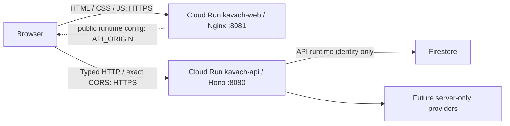
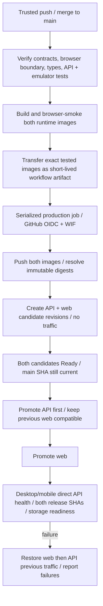

# GCP deployment and continuous delivery

Decision updated 17 October 2026 following the owner's requirement for independent frontend/API serving. This supersedes the earlier combined Hono/static-assets topology. Code and local tests are distinct from live GCP verification: no cloud resources have been provisioned. Project: `kavach-farmers-market-sense`; preferred region: `asia-south1` (Mumbai). See [owner setup steps](../deployment/gcp-setup.md).

## Selected topology

Use **two Cloud Run services in the same project and region**. An instance belongs to one service; it is not a shared VM for both applications. Each service has its own image, ingress port, runtime identity, revisions, scaling and failure lifecycle.

| Component | Serving process | Internal port | Public address |
| --- | --- | --- | --- |
| `kavach-web` | Unprivileged Nginx serving Vite output | 8081 | Its own HTTPS `run.app` URL; later `app.example.com` |
| `kavach-api` | Hono with the Node adapter | 8080 | Its own HTTPS `run.app` URL; later `api.example.com` |

Public connections use HTTPS **443** on both hostnames. Cloud Run terminates TLS and forwards to each configured internal port. Different public ports are unnecessary and are not how Cloud Run routes public services. Hono serves no React HTML/assets; Nginx has no API reverse proxy. Both `/api/*` on the web server and `/` on Hono return 404.

Cloud Run multi-container services have **one ingress container**, with sidecars reachable over localhost. Two containers on different local ports do not create two independently addressable public backends. A proxy could route them, but they would retain a shared instance/revision/scaling lifecycle. Independent services fit this application's boundary and recovery needs better. No Express migration, VM, Kubernetes or Docker Compose runtime is required.

## Containers and builds

Cloud Run runs containers. A handwritten Dockerfile is optional: `gcloud run deploy --source` uses a Dockerfile when present, otherwise Google Cloud buildpacks build a container. It still uses container images and a build service. Docker does not defeat Cloud Run's managed runtime; Google manages instances, TLS, scheduling and scaling after deployment.

We select explicit Dockerfiles for reproducible Node/npm versions, monorepo build boundaries and testing the exact deployed artifacts. `infra/Dockerfile.api --target builder` produces the shared Turbo build stage (`kavach-builder`); API and web runtime images are then built separately. The web image receives only static output plus Nginx configuration, with no Node backend/SDKs/credentials. The API image receives clean production dependencies and compiled API/contracts/domain, with no web output or development tooling. Both run unprivileged.

Turbo schedules the dependency graph; it does not deploy services. Keep the type-only Hono → client → web build dependency so shared contract changes rebuild the UI. Build both images on main initially rather than trying to infer deployability from changed paths. `apps/docs` is excluded.

The web image requires an explicit API_ORIGIN at startup. It loads `/runtime-config.js` before its module bundle. Nginx templates this non-secret API address at startup and sets `connect-src` to that exact origin. The image can move between environments without recompiling React. Config and HTML revalidate; no service key belongs there. The browser client uses credentials only on its configured API requests and validates response schemas.

## Cross-origin security and domain rollout

`APP_ORIGIN` on Hono is the **frontend origin**, not the API URL. Hono returns credentialed CORS only for that exact value, allows GET/POST/PATCH/DELETE with Content-Type/X-CSRF-Token/Idempotency-Key, and validates preflight requests. It retains CSRF, session ownership, quotas and strict input/output validation. It never uses wildcard CORS or reflects arbitrary origins. The frontend uses `credentials: include`; production cookies remain host-only, Secure, HttpOnly, SameSite=Lax, Path=/ (`__Host-kavach_session`). CORS is a browser permission, not authentication.

The owner has deferred buying/configuring a domain. Therefore the **first two-URL deployment verifies health only**, which needs no session. Default service URLs have distinct sites under the Public Suffix List's `*.run.app` entry. Treating these as sibling cookie domains is incorrect. Hono permits exact-origin cross-site health/capabilities/OpenAPI, but rejects browser cross-site session/resource access. We deliberately do not switch to third-party cookies, expose session tokens to JavaScript or claim the farmer journey works on those default URLs.

Before releasing guest farms/plans, configure HTTPS sibling hosts such as `app.example.com` and `api.example.com` under the same registrable domain. Verify their same-site status using browser tests. Keep the session cookie host-only on the API; no shared Domain cookie is needed. Untrusted sibling subdomains still fail Hono's exact Origin/CSRF checks.

For Mumbai, plan a **global external Application Load Balancer with two serverless NEGs**, host rules, Google-managed certificates and DNS. Each host routes to its own Cloud Run service/port; the load balancer does not serve the React build through Hono. Google's direct Cloud Run domain mappings are limited-region preview functionality, explicitly not recommended for production, and Mumbai is not in their listed regions. Domain purchase, DNS, certificates and load-balancer provisioning remain a later infrastructure batch with separate recurring costs. Do not move the app's region merely to use preview domain mapping.

When that batch is ready, validate certificates and routing, update APP_ORIGIN/API_ORIGIN, then deploy both services and test real secure-cookie guest → farm → plan persistence on desktop/mobile before exposing those screens. If restricting service ingress to the load balancer later, use Cloud Run's internal-and-cloud-load-balancing setting and update probes/smoke accordingly; the current health foundation intentionally uses direct public ingress.

## Main-to-production delivery

PR checks have read-only GitHub access and no cloud identity. The deploy job runs only after verification on trusted main, with `GCP_DEPLOY_ENABLED=true`, in the main-restricted `production` environment. Actions are pinned by commit SHA. OIDC trust binds numeric repo/owner IDs, main, exact workflow, event and production subject; no service-account key is stored. Production jobs serialize without cancelling in-flight promotions. Superseded commits cannot promote.

Each service must already have public access configured by bootstrap and one known previous revision receiving 100% traffic. The deployer refuses to overwrite a traffic split or change IAM. It pushes the already tested images, resolves sha256 digests and stages both no-traffic revisions. Startup probes gate candidates. The final main check occurs before traffic changes. The API promotes first; old UI/new API compatibility is mandatory. Live smoke checks both release headers, direct cross-origin API health, the two-origin network allowlist, responsive layout and API storage readiness without creating production records.

**Two-service rollout is not atomic.** On failure, restore the web and then API traffic, attempt every restoration even if another fails, and report manual recovery details if rollback fails. A lost promotion response still triggers restoration. Keep contracts and data formats compatible with current and previous releases; use additive changes and expand/migrate/contract when schema evolution arrives. A browser tab can retain an older UI after a deployment; that remains another reason to keep API compatibility. No retained-old-static-asset storage is implemented yet: future lazy-loaded routes need an asset-retention/versioning strategy before rollout. Traffic rollback never undoes Firestore writes.

`infra/cloudbuild.yaml` is a build/push-only alternative. Do not activate an independent deploy trigger that bypasses GitHub verification.

## Failure and recovery behavior

| Failure | Behavior / limit |
| --- | --- |
| Web process exits or liveness repeatedly fails | Cloud Run terminates/replaces that service's instance; API service is independent |
| API process exits or liveness repeatedly fails | Cloud Run replaces the API instance; frontend remains accessible and shows API failure/retry |
| Candidate cannot start or access Firestore | Startup/readiness checks prevent promotion; previous production revisions retain traffic |
| Web promotion/live check fails | Pipeline restores previous web/API traffic; failed restorations require operator recovery |
| Firestore/provider outage after a successful release | API reports unavailable/failure; liveness stays process-only to avoid restart storms; monitoring/operator response is needed |
| New release becomes faulty later | Cloud Run does not automatically infer application regressions and roll back; use alerts and the recorded manual rollback procedure |
| Container replacement / scaling to zero | Firestore survives; local disk does not. SQLite is rejected in production |
| Mutation response is lost | Server idempotency supports replay with the same operation key; UI must not invent a new key for a retry |

The API /readyz storage endpoint is used for startup gating and live checks; a continuous Cloud Run readiness probe is not configured. Liveness remains process-only.

Hono handles SIGTERM, stops accepting requests and closes its store within an eight-second deadline. Nginx handles its own shutdown. Min instances 0 permits cold starts; max 3 per service, 1 CPU/512 MiB and concurrency 20 are initial POC limits, not measured capacity or cost guarantees. A warm instance can be considered after measurement. Cloud Run replacement is not zero-downtime proof; interrupted/in-flight requests can fail.

Provision logging/uptime/error alerts and budget notifications as operational acceptance work; these are not created by the current bootstrap. Alerts-only budgets do not cap spend; spend-cap budget support has eligibility restrictions. Retain active/previous registry digests deliberately. Backup/PITR and disaster-recovery objectives remain a later database operations decision.

## Identities and provisioning

- Bootstrap operator: authorized project administrator for API enablement, IAM, registry, Firestore/rules/indexes/TTL, services and public access. Never grant that scope to CI.
- `kavach-runtime`: API runtime, Firestore data access only in the dedicated app project; future secrets scoped individually.
- `kavach-web-runtime`: separate web runtime with **no project data/provider permissions**.
- `kavach-deploy`: registry writer, Run Developer on both existing services and Service Account User on both runtime identities. No service IAM-policy editing.
- Google-managed Cloud Run service agent: platform image-pull/runtime duties; distinct from application identities.

Bootstrap defaults to an offline plan. Cloud Shell or an authorized managed GCP identity is needed for --apply. The current Codex environment has no GCP identity/secrets; gcloud is installed but unauthenticated. GitHub code access does not grant GCP access, and the current integration cannot administer GitHub environments (403). The owner guide includes manual steps.

Non-secret GitHub settings are the previous ten plus `GCP_WEB_SERVICE`, `GCP_WEB_RUNTIME_SERVICE_ACCOUNT`, `API_ORIGIN` (13 total). Default APP_ORIGIN is the web service URL; API_ORIGIN is the API URL. WIF supplies authorization; these identifiers do not. Domain changes will be deliberate configuration updates after routing is provisioned. Never put credentials in chat, browser config, images or Vite variables.

## Official research sources

Reviewed 17 October 2026:

- [Container contract: one ingress container, PORT, TLS and shutdown](https://docs.cloud.google.com/run/docs/container-contract)
- [Multiple containers and sidecar localhost communication](https://docs.cloud.google.com/run/docs/deploying#sidecars)
- [Source deployment: Dockerfiles or buildpacks](https://docs.cloud.google.com/run/docs/deploying-source-code)
- [Custom domains: load balancer recommendation and domain-mapping limits](https://docs.cloud.google.com/run/docs/mapping-custom-domains)
- [Public Suffix List: `*.run.app`](https://publicsuffix.org/list/public_suffix_list.dat)
- [Health checks and liveness recovery](https://docs.cloud.google.com/run/docs/configuring/healthchecks)
- [Traffic migration and rollback](https://docs.cloud.google.com/run/docs/rollouts-rollbacks-traffic-migration)
- [Public access](https://docs.cloud.google.com/run/docs/authenticating/public)
- [Deployment roles](https://docs.cloud.google.com/run/docs/deploying)
- [Deployment pipeline federation](https://docs.cloud.google.com/iam/docs/workload-identity-federation-with-deployment-pipelines)
- [Service identity](https://docs.cloud.google.com/run/docs/securing/service-identity)
- [Firestore locations](https://docs.cloud.google.com/firestore/native/docs/locations)
- [Billing budgets](https://docs.cloud.google.com/billing/docs/how-to/budgets)
