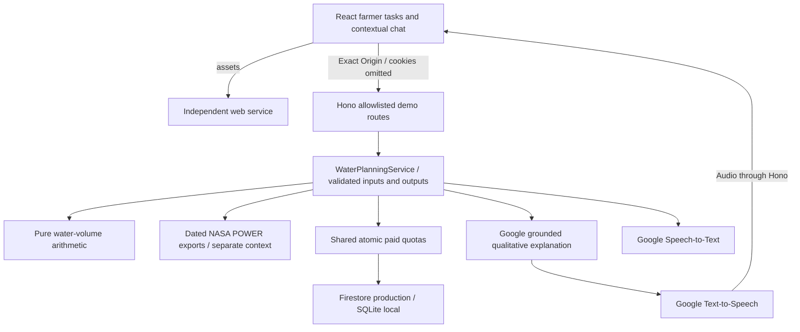

# Farmer planning POC

Updated 18 October 2026. The first farmer-planning release (`f534908`) deployed successfully through CI run 39130726106. The current UI refinement replaces dialog chat with a full Talk route; its rollout must be verified against the new commit rather than inferred from the earlier release. Research and design artifacts remain git-ignored under `.context/`.

## Experience

The main planning journey is **My situation → Compare → Next steps** at `/situation`, `/compare`, `/next-steps`, with a separate **Talk** tab at `/talk`. `/` redirects to the first task. Users select location and crop without writing a prompt, edit numeric assumptions in a separate confirmation dialog, compare two areas, explicitly select an option for discussion, and print a take-away sheet. Cancel discards edits. Confirmed changes invalidate the old selection and chat context. No account, persistent personal farm profile or saved-plan interface is required.

Latur, Beed and Nanded are selectable example locations. Chickpea/gram, sorghum/jowar and wheat are crop labels that personalize headings and explanation context; **they do not change application depth, efficiency, sowing suitability or crop recommendations**. Defaults are a synthetic three-acre example with 180,000 litres, 20mm net application and 70% efficiency. Application values are prominently illustrative and unreviewed. Known zero water calculates zero coverage; unknown water returns needs-input. This is one application, not total crop-season water demand.

Talk is a normal application route with a scrollable conversation and visible text/microphone composer, not a dialog. Typed questions, suggested questions and Google spoken replies remain grounded in current plan context. Tap to speak, tap to finish sends the recognized question for a short reply; Cancel releases the recording without sending. This read-only question flow never edits numeric fields. Leaving Talk or changing language cancels pending work/recording and releases playback. Voice on/off controls playback preference. Up to six bounded historical messages supply untrusted conversational context; they cannot establish facts. The UI retains twelve messages, locale and spoken-reply preference in visit memory, without localStorage/sessionStorage. Reload clears them. English is default, with Hindi/Marathi UI and Google speech; translations and field recognition still need native-speaker/physical-device review. Marathi chirp_3 recognition is a provider preview feature.

The planning stylesheet is isolated from legacy demo styles and uses one spacing/type/color system aligned with the HTML prototype. A decorative field illustration adds farm context; it is not a satellite map or a measured field boundary. Desktop uses quiet navigation and a two-column task layout; mobile uses four labelled tabs, with Talk's composer in its own fixed layout row rather than an overlay.

`/evidence` shows the selected location's historical rainfall comparison, interval, baseline, source, retrieval time, approximate coordinates and resolution. The legacy `/sample`, `/sample/compare`, `/season`, `/sources` demonstration remains accessible but is no longer the default journey. `/health` is independent and creates no planning requests.

## Boundaries and data flow

The browser imports only public contracts and the browser-safe client. Hono serves no React build. No provider SDK, direct map/weather call, external font, signed upload or credential enters the browser. Domain code calculates numbers; Google explains known facts qualitatively. No model-generated HTML or executable UI is used. AG-UI/A2UI are researched follow-up options, not implemented protocols. ADK is not required for this bounded orchestration.

## Arithmetic and validity

`packages/domain/src/water-planning.ts` uses 1 acre = 0.40468564224 hectares. Gross volume in m³ = hectares × net depth in mm × 10 ÷ efficiency. Litres = m³ × 1,000. Area covered is usable litres divided by gross litres per acre. Intermediate results are not rounded. FAO supports dimensional conversion and accounting for losses; it does not validate the supplied application depth or local crop suitability.

The available branch contains two options, required volume, signed balance and coverage. The needs-input branch identifies missing water/depth/efficiency and contains no numeric result. Crop choice is context only. Neither a water surplus nor selecting a scenario constitutes sowing approval. Field moisture remains unknown. No calibrated crop-risk score, yield prediction, savings claim or reviewed agronomic recommendation is implemented.

The print view preserves inputs, units, method version, limitations, open checks, source link and generation time. It is a discussion artifact, not a persisted or approved farm plan.

## Public transport and inference

Nine exact method/path pairs are public synthetic operations: four new planning/catalog/calculation/explanation/transcription routes and five legacy sample routes. Exact configured Origin, strict contracts, bounded bodies, route-specific preflights, shared overall request quota and cookie-free client behavior remain. Other routes retain session, CSRF and ownership handling; no general cross-site exemption was added. Contracts and OpenAPI cover both available and missing-input results.

New explanation uses a bounded question enum and optional text (1,200 characters) plus at most six 600-character history items. The server treats all conversational text as untrusted, recomputes the plan and passes canonical qualitative facts/budget states to Google. Model output is schema-validated, topic references are allowlisted and unsupported numeric/dose/date claims are rejected. These checks reduce unsupported output; they are not scientific validation. The deterministic cards remain authoritative when AI is unavailable. Runtime validation also covers outgoing responses.

Each paid call reserves existing atomic minute/day model/STT/TTS budgets, including failed attempts. No automatic paid retry or arbitrary numeric-input explanation cache was added. Legacy finite sample text cache remains unchanged. Shared budgets are 10 model calls/minute, 100/day, 180 STT seconds/minute, 1,800/day, 6,000 TTS characters/minute and 60,000/day by default. Request cancellation and 25-second inference deadlines propagate to providers. Audio is bounded PCM16 mono 16kHz WAV for upload and bounded MP3 for playback. No transcript/audio conversation persistence is introduced.

## Rainfall evidence

NASA POWER `PRECTOTCORR`, MERRA-2, UTC daily grid values. All comparisons use June–August 2026 and the matching complete 92-day period across 1991–2020. Exporters verify units, date completeness, fill/missing values and nonnegative rainfall; no missing day becomes zero.

| Selected location | June–August 2026 | 1991–2020 mean | Departure |
| ----------------- | ---------------- | -------------- | --------- |
| Latur             | 250.53mm         | 412.10mm       | −39.2%    |
| Beed              | 195.79mm         | 405.27mm       | −51.7%    |
| Nanded            | 506.29mm         | 572.12mm       | −11.5%    |

These are coarse model/reanalysis grid averages near approximate town centres, **not district averages or field observations**. They do not measure current soil moisture, forecast rainfall, establish an El Niño causal effect or drive the water calculation. June–August is not the full monsoon. [NASA documents the MERRA-2 grid and methodology](https://power.larc.nasa.gov/docs/methodology/meteorology/).

Reproduce Latur with `python3 scripts/evidence/export-latur-rainfall.py`; other locations with `python3 scripts/evidence/export-planning-regions.py`. Raw downloads are ignored under `.data/`; small validated snapshots are packaged with the API. Export once rather than call a public provider on every page view. Earth Engine API is enabled, but project registration was blocked; no satellite map is claimed. IMD/CRIDA reviewed current guidance remains a separate follow-up requiring actual source acquisition and local applicability review.

## Configuration and deployment

Node 24.15+ and npm 12.2.0. Local SQLite and disabled providers need no GCP account. `EXPLANATION_PROVIDER=google`, project/model/location configuration and ADC enable Google; explicit local-only `LOCAL_GCLOUD_AUTH=true` uses short-lived authenticated CLI tokens. Production rejects that flag, emulator/local storage and localhost origins, using attached identity and Firestore instead. No JSON key is generated.

Current configured model is gemini-3.8-flash/global; STT chirp_3/us; TTS English/Hindi/Marathi Chirp3-HD-Aoede. Provider/data permissions stay on the API runtime identity. Web and CI identities have no provider/data roles. No new IAM or infrastructure service was required for the planning extension. CI must verify and promote exact tested image digests through trusted main; this local change is not production verification.

## Verification status

Local `build:app`, `check:app` (including boundaries, lint and negative RPC types), existing API/contracts/domain/client suites, OpenAPI drift, deployment guards, Firestore emulator parity and all twelve existing browser tests pass. Both images build; API workflow/restart persistence and independent Nginx/API container smoke pass, preserving CSP, exact origin assertions, release mismatch detection and outage recovery. The container harness explicitly selects disabled provider mode and asserts that state; the production smoke still requires actual Google explanation/model metadata and audio.

Exploratory Playwright covered the complete mobile/desktop flow, location/crop changes, cancel/confirm edits, zero versus unknown water, selection invalidation, evidence, printable output, typed chat retention, real STT, real English and Marathi model/audio, denied microphone and network recovery. Only web/API origins were observed, with no page errors or horizontal overflow in completed walks. Independent review found two receipt gaps; balance, one-application/assumption limits, method version/formula/source were added and the final A4 sheet renders on one page. Generated audio/fake-microphone checks do not establish physical-device or field-noise quality.

No new test cases were added, per user instruction. Arithmetic/UI verification does not establish farmer comprehension, agronomic validity or measured outcomes. Physical-device use, native-speaker review and locally reviewed application inputs remain acceptance work. Live rollout verification is recorded separately after CI; local CLI-owner provider calls are not attached Cloud Run identity verification.
