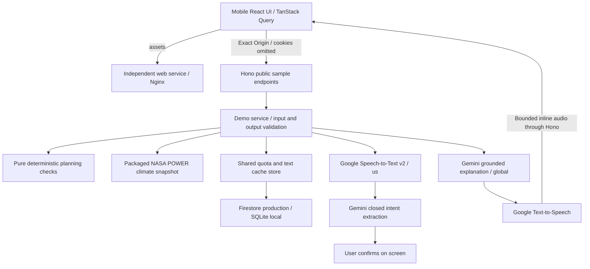

# Voice-first sample POC

Updated 18 October 2026. Implemented locally; **this change has not been deployed to Cloud Run**. Infrastructure and the earlier health foundation are live. Research, alternatives, design plan and execution notes are in the git-ignored `.context/` directory.

## Experience and scope

The home route is a mobile-first English sample for Latur chickpea planning. Users can switch to Hindi or Marathi, choose irrigation availability, confirm the proposed change and compare it with the original single-irrigation sample. Field moisture remains unknown. A Google-generated explanation can be read or played. `/health` retains the independent diagnostic screen.

Voice uses tap to start and tap to finish, capped at thirty seconds. The app records locally into PCM16 mono 16 kHz WAV and uploads only when finished. Hono validates the complete WAV, recognizes it through Google Speech-to-Text v2, extracts a closed intent with Gemini and returns a short Google-spoken confirmation. The user confirms on screen before the scenario changes. No continuous listening, automatic farm update, freeform chatbot, login or saved-plan interface is implemented. Marathi `chirp_3` recognition is a provider preview feature; localization has not had a native-speaker usability review.

These are unreviewed planning checks, not agronomic prescriptions. No dates, doses, yield improvement, crop-loss probabilities, measured soil moisture or drought prediction are provided. The sample is synthetic; rainfall context is a real, dated, coarse regional data snapshot.

## Boundaries and orchestration

Hono owns transport/validation; `DemoService` owns ordering, comparison, cache and budgets; adapters own Google SDK/REST calls. Domain code receives no SDKs or model output. Browser imports are limited to the public contracts and browser-safe client. No browser service SDK, credential, external font, signed upload, direct Google call or telemetry is added.

Google ADK was considered. This flow has fixed steps and no autonomous tool discovery. The official Google GenAI SDK plus service orchestration keeps cancellation, confirmation and resource limits explicit. ADK can be reconsidered for a later multi-tool discovery feature; it is not required by this implementation.

## Public API and security

The four exact route/method pairs are public synthetic operations; all other routes retain private session, CSRF and ownership handling. Mutations require the exact configured `APP_ORIGIN`. Preflight allows only the matching method and Content-Type; no credentialed CORS is returned. Public transport uses `credentials: omit`, ignores cookies and creates no farmer records.

| Method | Route                                  | Request                                                       |
| ------ | -------------------------------------- | ------------------------------------------------------------- |
| GET    | `/api/v1/demo/scenarios`               | Server-owned sample, context, sources and historical snapshot |
| POST   | `/api/v1/demo/assess`                  | Scenario ID plus optional irrigation enum                     |
| POST   | `/api/v1/demo/explain`                 | Same input, locale, fixed question enum, optional voice       |
| POST   | `/api/v1/demo/transcribe?locale=en-IN` | Bounded audio/wav, not arbitrary text                         |

Strict Zod schemas reject unknown fields and caller-supplied farm/owner/location overrides. The existing 16 KiB JSON bound stays unchanged. Audio is at most 1 MiB and thirty seconds; upload deadline is ten seconds. Model/speech calls share a twenty-five-second cancellation deadline. Responses are validated and use the existing `{data,meta}` / structured error envelopes. Audio output is MP3, at most 512 KiB decoded, returned inline through Hono. Nginx permits blob audio and self-hosted worklet code.

Shared minute/day budgets are atomic transactions in the existing quota collection: model 10/100 requests; STT 300/3000 audio seconds; TTS 12000/120000 text characters. All public calls also share a 120/minute request ceiling. No user can get unlimited inference by changing a cookie or restarting a container. Exceeded budgets return 429; deterministic checks stay available unless the general request ceiling is reached. The cache is a finite combination of sample/version, rules, prompt version, provider/location/model, language, question and irrigation, with a fifteen-minute expiry. Only verified-shape explanation text and original model metadata are cached, never audio or transcripts. Application expiry checks apply independently of Firestore TTL cleanup.

## Climate evidence

`apps/api/src/evidence/latur-rainfall.json` is generated with `scripts/evidence/export-latur-rainfall.py`. NASA POWER daily `PRECTOTCORR` / MERRA-2, API v2.10.0, at 18.4088 N, 76.5604 E. Jun–Aug 2026 totals 250.53 mm; the same ninety-two-day window in 1991–2020 averages 412.10 mm; departure −39.2%. The export checks units, fill values, complete dates, all thirty baseline years and nonnegative rainfall. Raw downloads stay outside Git. Rebuild with `python3 scripts/evidence/export-latur-rainfall.py` (or its documented `--input` option).

This is a 0.5° × 0.625° district-centre grid sample, not a district mean or field measurement. It is historical context, not a forecast, irrigation prescription or causal El Niño attribution. It is displayed separately and does not alter the deterministic rules. Earth Engine API was enabled but project registration is missing; the documented NASA fallback was selected rather than mislabelling fixture data as live satellite evidence.

## Local and production configuration

Node 24.15+ and npm 12.2.0 are required. Copy `apps/api/.env.example` to `.env`, install, and run `npm run dev`. The default needs no cloud credentials and shows clear disabled-provider states. To use real Google services locally, set `EXPLANATION_PROVIDER=google`, `GOOGLE_CLOUD_PROJECT`, and either ADC or explicit local-only `LOCAL_GCLOUD_AUTH=true` with an authenticated gcloud CLI on PATH. The latter uses short-lived CLI tokens in memory; production rejects it. No JSON key is generated.

Selected model: `gemini-3.8-flash`, location `global`; STT `chirp_3`, location `us`; TTS `en-IN`, `hi-IN`, `mr-IN` Chirp3-HD-Aoede. The API service account has Vertex AI User, Speech Client, Service Usage Consumer and its existing Firestore role. The web and CI identities receive no provider/data roles. Provisioning code records the required APIs and roles. Deploy config passes the provider/model/location values explicitly to the API only; defaults select Google in deployment and remain disabled for unconfigured local development. Production requires Firestore/ADC and refuses emulator/local-storage/localhost configurations.

## Verification and remaining limits

Local production build and boundary checks passed. Existing API and browser suites passed; no new test cases were written. Existing health tests were pointed to `/health`, preserving their two-origin, response-validation, recovery, cookie and CSRF coverage. Playwright manual walkthroughs exercised mobile/desktop layout, irrigation confirmation/comparison, Marathi switching, real Google explanation/audio and the complete microphone path using generated sample audio. Real English/Hindi/Marathi audio transcribed into the correct no-irrigation proposal and returned Google confirmation audio. These generated-audio checks do not establish recognition quality for farmers, accents, background noise or every device.

Actual Cloud Run runtime identity/provider calls, final production image and deployed judge journey still require the next trusted main rollout. Local CLI-owner calls are not runtime-identity verification. Both API and web Docker images built and ran locally. A Playwright walk through the actual Nginx image confirmed the strict CSP, two-origin boundary, server-selected comparison and disabled-provider state. Voice capture and blob playback also passed under that Nginx CSP against the local Google-enabled Hono process. Google adapter modules loaded in the API runtime image; that check is not an attached Cloud Run identity probe. CI builds and smoke-checks exact tested digests before promotion. Native microphone capture and speaker output on a physical phone remain a user acceptance check.

The production `demoCache.expiresAt` TTL was verified ACTIVE on 18 October 2026. Text/expiry index exemptions were submitted with the maintained infrastructure definitions.
