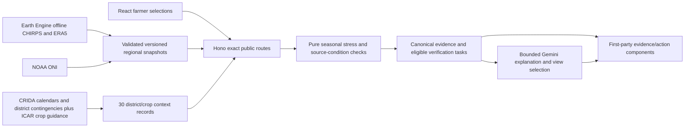

# Maharashtra seasonal-readiness engine

18 October 2026. Core backend batch; frontend and live rollout status recorded in backend-foundation.md. Implements the brief's Sense → Compare → Decide → Explain boundaries with honest coverage limits.

Ten locations: Latur, Beed, Nanded, Dharashiv/Osmanabad, Parbhani, Hingoli, Jalna, Chhatrapati Sambhajinagar/Aurangabad, Solapur, Ahilyanagar/Ahmednagar. Crops: gram/chickpea, **rabi** jowar/sorghum, wheat. These are approximate town-centre grid samples, **not district means or field observations**. Regional and crop scope must match exactly in the pure engine.

## Acquired evidence and reproducibility

`apps/api/src/evidence/season-readiness/regions.json` contains strict validated snapshots for all ten locations. CHIRPS v3 DAILY_RNL (0.05°/~5.6 km) totals June 1–September 30, 2026 and matching historical years; baseline 1991–2020, 122 complete daily grid values per region-year. Four historical examples: 2002, 2009, 2015, 2023; no causal or probability interpretation. Baseline uses the same product/window/geography. Departure = 100×(current/baseline−1). Do not compare this JJAS product against the older NASA JJA baseline.

ERA5-Land surface soil water (0–7 cm, m³/m³) and mean daily maximum 2m air temperature (converted Kelvin→Celsius), September 2026 versus matching 1991–2020 means, 30 complete days per region-year, ~11 km. It is modeled surface context, **not today's field/root-zone measurement**. NOAA ONI is three-month Pacific SST context: historical examples use JJA, current context JAS. Positive ONI does not itself predict a particular district's drought. Source URLs, retrieval timestamps, geographic scope, methods, resolution and raw snapshot SHA256 are embedded in public evidence metadata.

Use `scripts/evidence/export-season-history.py` and `export-surface-context.py` only explicitly with `--run` in a separate local Python environment with `earthengine-api`, ADC/operator credentials and verified project quota. They default to offline plans, have finite queries/deadlines, no task/schedule creation and no retries. The history exporter uses one multiband reduction to avoid concurrent aggregation fanout. Raw output goes under ignored `.data/research/climate/`; `build-season-pack.py` packages acquired raw CHIRPS/ERA5 and `.data/readiness/oni.txt` without network calls. Download ONI from the exact source URL recorded in the snapshot first. No paid per-view EE requests or runtime EE permissions are needed. Production serves packaged JSON through Hono. MODIS research samples are deliberately excluded: urban town-centre pixels with no crop mask cannot establish crop health.

## Crop context and decisions

`actions.json` has thirty explicit district×crop entries with historical rainfed/irrigated calendar context, 2011 source URL/page/hash and acquired VNMKV October 13, 2026 bulletin coverage for eight Marathwada districts. The bulletin forecast ends October 18; its sowing window ends October 15. Solapur/Ahilyanagar have no current bulletin acquired in this pack. Historical calendars differ by district; Nanded's table even lists a rainfed wheat window, so no universal wheat assumption is imposed. All agronomic context is **unreviewed**.

`assessSeason` is pure and receives explicit server time. It enforces matching region/crop evidence and emits regional below/at-above-baseline context, missing prerequisites, four conditional **verification tasks**, current/expired/historical-only source status, reasons and method/rule versions. Tasks vary with crop, stage, field-moisture observation, soil depth and irrigation certainty. User-reported moisture is separate from modeled surface moisture. A historical calendar or an expired bulletin cannot approve sowing. No calibrated farm-risk number, yield-loss probability, chemical/variety/dose/date prescription, independent agronomic review or measured impact is claimed. Those remain substantive gaps relative to the full brief, not completed capabilities.

## API and explanation boundary

`POST /api/v1/demo/readiness` accepts strict finite region/crop/intent/stage/soil/moisture/irrigation choices. `POST /api/v1/demo/readiness/explain` adds bounded question/history, locale and voice. Both are exact allowlisted public synthetic operations with the existing exact-Origin CORS, body bounds, overall shared rate limits and credential-omit client. All private session/CSRF/ownership behavior remains. The service recomputes the assessment; browser-supplied evidence or ownership is never trusted. Outgoing results are validated.

Google explains only the canonical assessment and chooses one/two finite visual topic IDs. The service binds all components to its own assessment; no arbitrary HTML/JSX/URLs/model measurements. Numerical facts stay in canonical cards; generated prose rejects numeric/dose/date claims. This reduces unsupported output and does not prove scientific/linguistic correctness. Existing shared model/STT/TTS budgets reserve before each paid call; no automatic paid retry. No additional framework, cloud identity, service or data warehouse was added.

## Decide extension: sourced crop options and regional stress

The assessment also carries `stress` and `cropOptions`. `stress` is an **experimental regional water-stress indicator**, not a calibrated farm-risk or loss probability. The empirical dry-rank is `(count(baseline < current) + 0.5 × count(equal)) / 30 × 100`, using the complete matching 1991–2020 rainfall and modeled surface-moisture series. High = both ranks ≤20; moderate = one; lower = neither. Thresholds are prototype design choices, not claimed reviewed agronomic thresholds. A lower indicator does not approve sowing. The dated observation window and modeled-surface limits remain visible.

`crop-guidance.json` contains seven curated, unreviewed discussion rules with source URL, exact page/section, raw SHA256 and scope. Four general crop rules come from ICAR-IIPR precision-irrigation research (gram branching/pod development), ICAR-IIMR's rabi-sorghum guide (limited one-irrigation discussion at flower-primordial/boot-leaf stage; app matches boot-leaf), and ICAR-IIWBR's wheat pocket guide (one-irrigation crown-root initiation; moisture-sensitive crown-root/flowering context). Three **district-only** historical contingencies concern Ahilyanagar wheat/chickpea alternatives, Chhatrapati Sambhajinagar gram alternatives, and Hingoli critical-stage wheat irrigation under low groundwater recharge. General crop guidance is never labeled a current district advisory. Historical source crop/variety names are context for discussion, not current seed recommendations.

The pure engine checks crop, district scope, selected stage, irrigation availability, user-reported dry-field condition, and required black/deep-soil and low-well-recharge categories. It emits `reported-context-matches`, `needs-input` or `different-context`, unmet facts and reason. “Reported context matches” means only these checked categories match; source-specific farming-system assumptions, current local suitability and independent rule review still require an adviser. No dose, operational date, automatic crop switch or prescription is produced. Other-context rules are collapsed in the farmer UI. District changes reset soil/moisture/water observations; crop changes reset stage/intent. Bulletin expiry uses the India calendar date from injected server time.

The complete thirty district/crop packs each receive applicable general crop rules plus their own district rules. This does **not** imply thirty independently reviewed district-specific contingency packs. The remaining full-brief gaps include expert-reviewed current agronomic prescriptions, calibrated farm risk, crop-masked vegetation, verified reservoir/service-area access and notified insurance deadlines. Source-backed discussion options improve the Decide layer without disguising those gaps.

Release review tightened applicability: chickpea two-stage discussion remains `needs-input` for one/limited/unknown supply until both-stage capacity is confirmed. District source conditions not collected by the form are explicit confirmation checks: open-well irrigation for Ahmednagar, source farming situation for Aurangabad/Hingoli. They cannot become reported-context matches solely from soil and well-refill selections. Hindi/Marathi cards include substantive crop guidance and missing-fact labels; experimental indicator copy explicitly says it is not a farm-loss probability estimate.

The Google inference projection excludes raw thirty-year baseline arrays, duplicate crop guidance and legacy water-climate snapshots. The engine still uses the complete baseline, and canonical cards retain the complete validated assessment. Inference receives computed evidence, source scope/limitations, crop-option conditions, missing facts and water calculation; it does not calculate risk from raw history. Seasonal explanation and optional TTS share one 35-second deadline; output-token and paid quotas remain unchanged, with no automatic retry.
