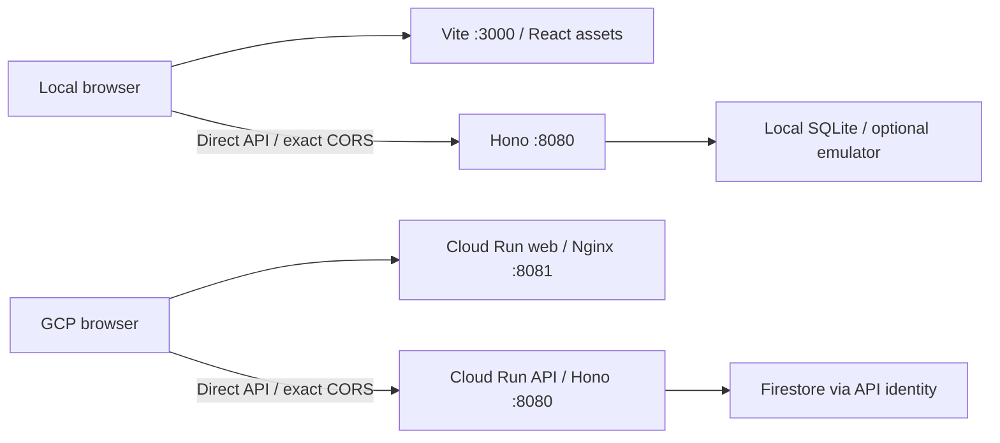
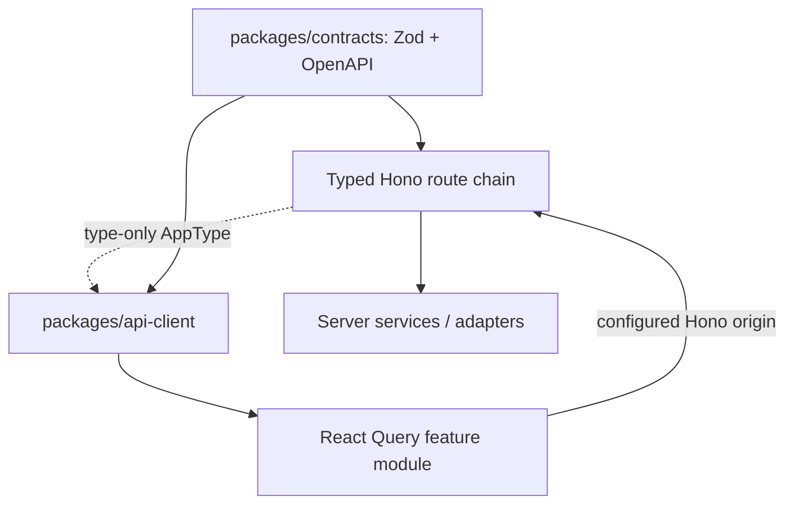

# Web foundation and Hono RPC

Updated 18 October 2026. The home route now provides the mobile voice-first sample, confirmed water comparison, historical context and English/Hindi/Marathi selection. `/health` retains the diagnostic foundation. See [POC implementation](poc-implementation.md) for current local verification and deployment limits.

## Runtime and GCP structure



Frontend and API are independently served. Hono serves no web output; its root returns 404. Nginx serves the web build, has no API proxy, and `/api/*` there returns 404. Public HTTPS uses port 443 for each hostname. See [deployment decision](gcp-deployment.md) for why Cloud Run sidecars cannot expose two independent ingress ports.

The API image receives compiled API/contracts/domain and clean production dependencies. The web image receives only static web output and Nginx configuration. Both are non-root; docs/build tools/server SDKs are absent from the web runtime. `infra/Dockerfile.web` consumes the separately built `kavach-builder` stage. Its `/runtime-config.js` contains only API_ORIGIN; Nginx templates this at startup, so React can use a new API address without rebuilding. Config/HTML revalidate. CSP permits self-hosted scripts/styles/images/worklets, blob audio and connections only to the configured API origin, without inline/eval. API responses retain strict JSON CSP.

Default Cloud Run URLs support the public synthetic demo without cookies after the new release is deployed. Only four exact demo route/method pairs receive the public exception. Full guest ownership still requires same-site sibling custom domains; cross-site private session/resource requests remain rejected. The owner deferred the domain. Local demo acceptance does not prove the next production rollout.

## Hono RPC without runtime coupling



`apps/api/src/rpc.ts` exports only `AppType`; the `@kavach/api/rpc` package export has a `types` condition and no runtime entry. Only the browser-safe client may `import type` this export. Its API workspace dependency is development-only for compilation. TypeScript erases it from emitted JavaScript; the client runtime imports `hono/client` and public contracts. The UI imports only `@kavach/api-client`.

Keep route definitions chained in `createApp`; mutating a Hono instance behind a void registration function erases RPC inference. Small typed middleware declares and validates JSON/query inputs and mutation headers. Domain logic and provider orchestration stay in services/adapters. Runtime response validation remains mandatory: RPC completion does not establish that actual network data is valid.

```ts
import { createRpcClient, readRpcResponse } from "@kavach/api-client";
const rpc = createRpcClient(fetch, "http://localhost:8080");
const health = await readRpcResponse("health", await rpc.api.v1.health.$get());

// Other routes expose JSON, path and header completion. Mutations require
// X-CSRF-Token and creations also require Idempotency-Key in the header input.
```

The existing schema-driven `createApiClient().request(...)` remains supported for transport-independent callers. Both clients accept an optional exact API origin as their second argument (`createRpcClient(fetch, apiOrigin)` / `createApiClient(fetch, apiOrigin)`). Configured-origin requests use credentials: include; relative mode remains available for non-UI callers. The browser automatically sends Origin on mutations; keep CSRF/idempotency tokens in request headers and derive ownership only on the server. Never place cloud credentials in Vite variables.

Security checks:

- `npm run check:boundaries` parses imports across web, client and contracts. External packages are allowlisted, relative imports must stay within their source package, and the sole server type exception is explicit. Runtime server imports, dynamic module paths and cloud SDK imports fail.
- Web ESLint rejects server/provider imports. Vite independently inspects its module graph and rejects API/domain/cloud SDK modules; public source maps are disabled.
- RPC type regressions use `@ts-expect-error` to ensure incorrect fields/crops, missing path parameters and missing mutation headers remain compiler errors.
- An API test compares Hono route method/path metadata against the public endpoint registry to prevent drift between RPC and OpenAPI.

## Local workflow

```sh
npm ci
cp apps/api/.env.example apps/api/.env
npm run dev
```

Open http://localhost:3000. Vite serves only the UI and its public runtime configuration; the browser calls Hono directly on http://localhost:8080. Keep APP_ORIGIN=http://localhost:3000 on the API. Vite's optional server-side API_ORIGIN overrides the local default; no secrets go there. There is no Vite API proxy. The API uses exact CORS, HttpOnly cookies and CSRF. Turbo watch rebuilds dependencies; tsx/Vite handle source changes. The docs starter remains `npm run dev:docs`.

Build with `npm run build:app`; `npm run start:api` starts only the API. `npm run preview --workspace=web` is a local asset preview, not a production server. Production uses Nginx; see [infra commands](../../infra/README.md). SQLite remains local tooling only.

## Health screen and verification

`GET /api/v1/health` returns the usual envelope with `status: ok`, `service: kavach-api`, `apiVersion: v1` and a server UTC timestamp. It is public and creates no session. `/healthz` remains the deployment liveness probe, and `/readyz` checks storage separately. A green UI health state proves a valid API response, not overall provider/database health.

The screen shows pending, success and failure states, round-trip duration, last response time, request ID and a retry control. Requests have a five-second deadline. It does not fake a successful result when offline, when the response fails schema validation, or after a failed refresh. There is no background polling; Query rechecks stale data on focus and the user can refresh manually.

Verification commands:

```sh
npm run build:app
npm run check:app
npm run test:api
npm run openapi:check
npm run test:firestore
npx playwright install chromium
npm run test:e2e
docker build -f infra/Dockerfile.api -t kavach-api .
node infra/tests/container-smoke.mjs kavach-api
docker build -f infra/Dockerfile.api --target builder -t kavach-builder .
docker build -f infra/Dockerfile.web -t kavach-web .
node infra/gcp/test-live-smoke.mjs kavach-api kavach-web
```

Playwright starts isolated API and Vite/preview processes. Desktop/mobile direct-origin and built-web tests cover health refresh, loading/failure/recovery, malformed responses, the exact two-origin network allowlist, no horizontal overflow, credentialed guest bootstrap/creation and wrong-CSRF denial. Container smoke verifies API workflow persistence; two-container browser smoke checks API pause/recovery with the web still available, real Nginx CSP/runtime config, independent ports, absence of API proxy/static serving in Hono, and both release SHAs. Live GCP IAM/WIF/routing remain unverified.
