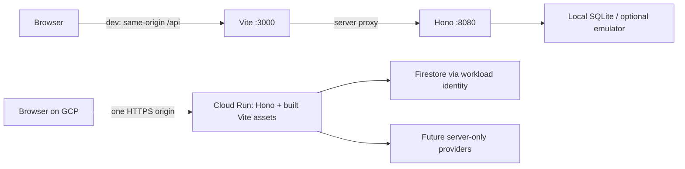
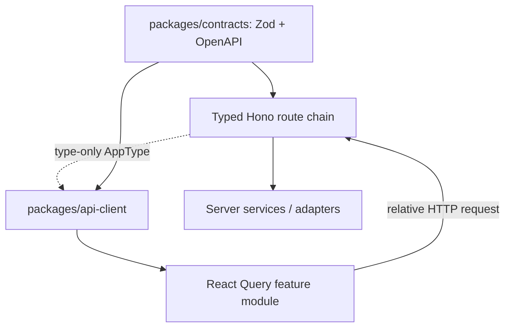

# Web foundation and Hono RPC

Updated 17 October 2026. Backend foundation merged through PR #1. This batch replaces `apps/web` with React/Vite, adds TanStack Router/Query and a real health screen. It does not implement farmer-facing forms or account login.

## Runtime and GCP structure



The web and API have separate packages and build commands. The POC deploys them together as one Cloud Run container: Node listens on PORT, Hono serves `apps/web/dist` and `/api/v1/*`, and production persistence remains Firestore. No second browser-facing service, CORS wildcard, cloud SDK or direct database path is introduced. `apps/docs` is excluded from the application image.

`infra/Dockerfile.api` builds both packages, then installs only production API dependencies in a clean stage. The runtime receives those dependencies, compiled API/contracts/domain and static web assets. It runs as a non-root user. Production startup rejects missing web assets and still requires valid project/HTTPS-origin/Firestore settings. Provisioning and live deployment remain deferred until a GCP project is selected.

API responses retain restrictive JSON CSP. HTML/assets allow only same-origin scripts/styles/images/connections, prohibit frames and objects, and do not allow inline scripts or eval. Frontend fonts/assets are local. Unknown API paths remain JSON errors, never the SPA document. Add explicit UI route namespaces to `apps/api/src/web.ts` as new screens are built.

## Hono RPC without runtime coupling



`apps/api/src/rpc.ts` exports only `AppType`; the `@kavach/api/rpc` package export has a `types` condition and no runtime entry. Only the browser-safe client may `import type` this export. Its API workspace dependency is development-only for compilation. TypeScript erases it from emitted JavaScript; the client runtime imports `hono/client` and public contracts. The UI imports only `@kavach/api-client`.

Keep route definitions chained in `createApp`; mutating a Hono instance behind a void registration function erases RPC inference. Small typed middleware declares and validates JSON/query inputs and mutation headers. Domain logic and provider orchestration stay in services/adapters. Runtime response validation remains mandatory: RPC completion does not establish that actual network data is valid.

```ts
import { createRpcClient, readRpcResponse } from "@kavach/api-client";
const rpc = createRpcClient();
const health = await readRpcResponse("health", await rpc.api.v1.health.$get());

// Other routes expose JSON, path and header completion. Mutations require
// X-CSRF-Token and creations also require Idempotency-Key in the header input.
```

The existing schema-driven `createApiClient().request(...)` remains supported for transport-independent callers. Both clients use relative paths and same-origin cookies. The browser automatically sends Origin on mutations; keep CSRF/idempotency tokens in request headers and derive ownership only on the server. Never place cloud credentials in Vite variables.

Security checks:

- `npm run check:boundaries` parses imports across web, client and contracts. External packages are allowlisted, relative imports must stay within their source package, and the sole server type exception is explicit. Runtime server imports, dynamic module paths and cloud SDK imports fail.
- Web ESLint rejects server/provider imports. Vite independently inspects its module graph and rejects API/domain/cloud SDK modules; public source maps are disabled.
- RPC type regressions use `@ts-expect-error` to ensure incorrect fields/crops, missing path parameters and missing mutation headers remain compiler errors.
- An API test compares Hono route method/path metadata against the public endpoint registry to prevent drift between RPC and OpenAPI.

## Local workflow

```sh
npm ci
cp apps/api/.env.example apps/api/.env
npm run dev
```

Open http://localhost:3000. Vite uses a fixed port and proxies `/api` to 127.0.0.1:8080. API configuration and secrets stay under `apps/api`; there is no frontend service URL/key configuration. Keep APP_ORIGIN=http://localhost:3000 for mutations through this proxy. Turbo watch rebuilds shared packages and restarts dependents; tsx/Vite handle API/UI source edits. Ports 3000 and 8080 must be free.

For the same-origin production serving path locally, run `npm run build:app`, set APP_ORIGIN=http://localhost:8080, then `npm run start:api`. SQLite remains explicit local mode; this is not a production GCP test. The original docs starter is available separately with `npm run dev:docs`.

## Health screen and verification

`GET /api/v1/health` returns the usual envelope with `status: ok`, `service: kavach-api`, `apiVersion: v1` and a server UTC timestamp. It is public and creates no session. `/healthz` remains the deployment liveness probe, and `/readyz` checks storage separately. A green UI health state proves a valid API response, not overall provider/database health.

The screen shows pending, success and failure states, round-trip duration, last response time, request ID and a retry control. Requests have a five-second deadline. It does not fake a successful result when offline, when the response fails schema validation, or after a failed refresh. There is no background polling; Query rechecks stale data on focus and the user can refresh manually.

Verification commands:

```sh
npm run build:app
npm run check:app
npm run test:api
npm run openapi:check
npm run test:firestore
npx playwright install chromium
npm run test:e2e
docker build -f infra/Dockerfile.api -t kavach-api .
node infra/tests/container-smoke.mjs kavach-api
```

Playwright starts isolated API/Vite processes and runs desktop/mobile proxy and built Hono journeys. Tests assert real health responses, fresh request IDs after retry, loading/failure/recovery, malformed-response rejection, no horizontal overflow and same-origin network requests. Container smoke verifies HTML/assets, CSP, typed health and saved-record persistence across restart.

## Batch review

- Web build, lint and typecheck pass, including negative RPC type checks and import guards. A deliberate server import was rejected by the guard and removed.
- Nine browser checks pass across desktop/mobile and built Hono serving. Desktop/mobile screenshots were inspected; the normal `npm run dev` path also returned a real API response.
- Final local review passed: 29 contract/domain/client/API/infrastructure tests, 11 Firestore emulator tests, nine browser tests, scoped build/lint/typecheck and OpenAPI drift. The complete application container built with its clean production dependency stage (zero audit advisories reported there); HTML/assets/CSP/health and record persistence across restart passed. Runtime inspection confirmed TypeScript, Vite, ESLint and Playwright are absent. CI repeats these gates; live GCP deployment remains unverified.
- Dependency review found four high-severity development advisories inherited through the existing shared Next ESLint plugin (`braces`/`micromatch`/`fast-glob`). These are not frontend runtime modules or production API dependencies; the clean runtime dependency install excludes build/lint tooling. No forced downgrade of the unrelated Next docs tooling is included.
